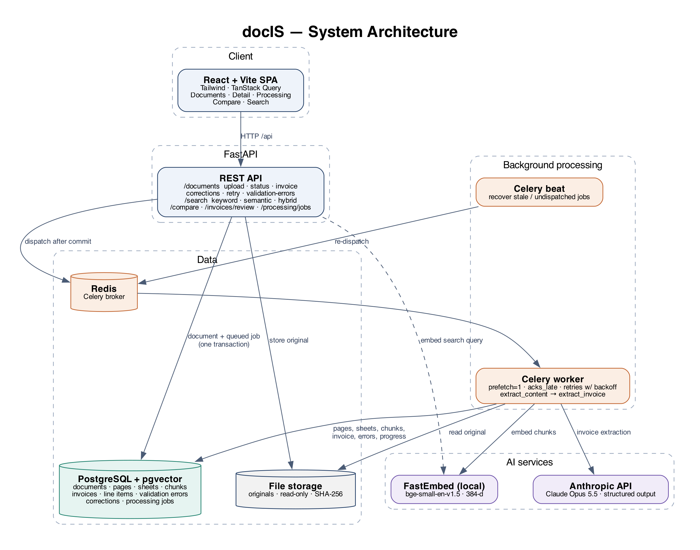
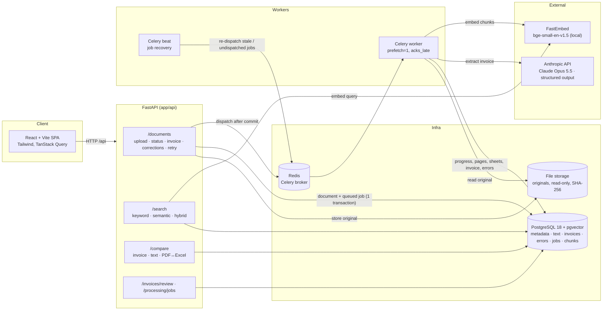
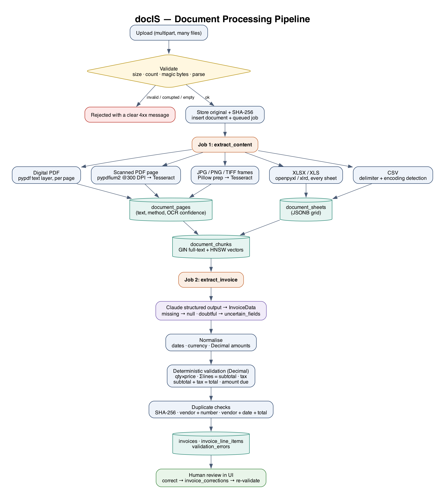
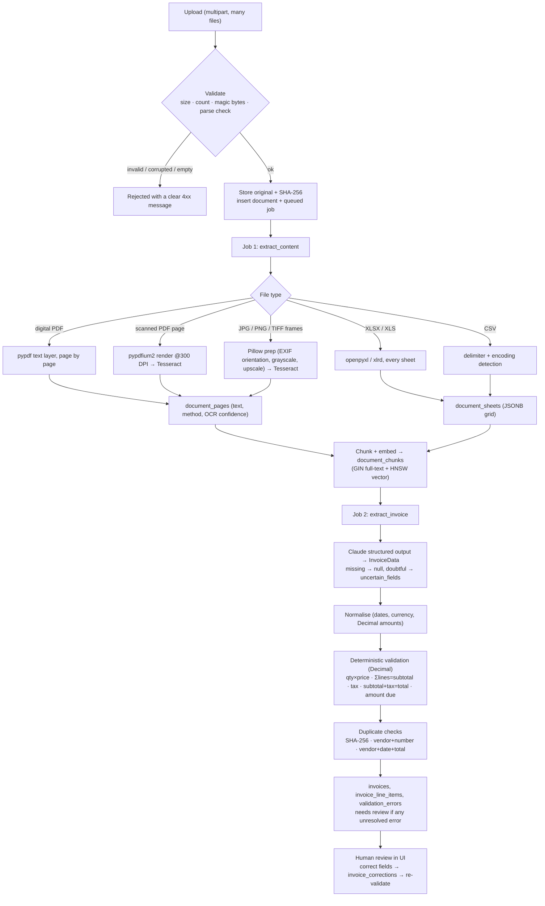

# System Architecture

PNG versions are in this folder:
- [`system_architecture.png`](system_architecture.png)
- [`processing_pipeline.png`](processing_pipeline.png)

They are rendered from the `.dot` sources with `dot -Tpng -Gdpi=200 <file>.dot -o <file>.png`.

## Components

## Processing pipeline (one document)

## Reliability

- **Job state lives in PostgreSQL**, not only in the queue. A job is claimed with `SELECT … FOR UPDATE`, so a duplicate delivery does nothing.
- **Heartbeat:** a running job writes progress and a heartbeat about once a second. Celery beat requeues a job whose heartbeat has gone stale, and re-sends queued jobs that were never dispatched.
- **Retries:** temporary failures retry with exponential backoff and jitter, up to `JOB_MAX_ATTEMPTS` (default 3) attempts. Permanent failures fail immediately with a readable error.
- **Manual retry:** `POST /documents/{id}/processing/retry` re-runs a failed document.

## Deployment

- **Local:** `docker compose up` (in `backend/`) starts the database, the migration step, the API, the worker, beat and Redis.
- **Hosted:**
  - Render (`render.yaml`) runs the API, the worker and beat in one Docker service with a persistent disk, plus managed Postgres and Redis.
  - Vercel (`frontend/vercel.json`) serves the static frontend and forwards `/api/*` to the API.
