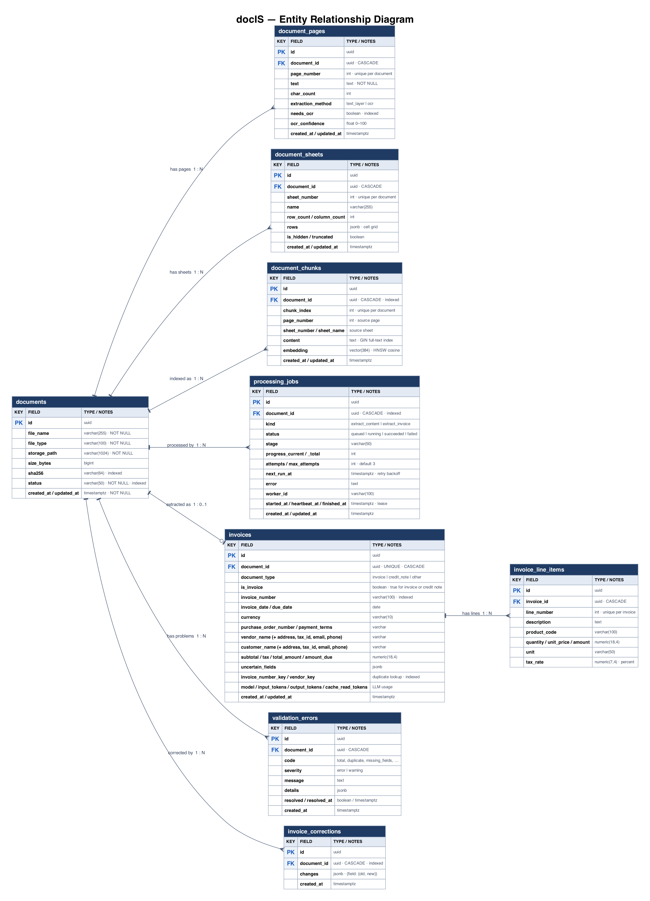

# Database Schema

## Entity Relationship Diagram



The PNG is rendered from [`database_schema.dot`](database_schema.dot). The Mermaid version is below.

```mermaid
erDiagram
    DOCUMENTS {
        uuid id PK "default uuid4 (app-generated)"
        varchar(255) file_name "NOT NULL"
        varchar(100) file_type "NOT NULL, e.g. application/pdf"
        varchar(1024) storage_path "NOT NULL"
        bigint size_bytes "bytes stored"
        varchar(64) sha256 "indexed, hex SHA-256 of original"
        varchar(50) status "NOT NULL, indexed"
        timestamptz created_at "NOT NULL, default now()"
        timestamptz updated_at "NOT NULL, default now(), on update now()"
    }

    DOCUMENT_PAGES {
        uuid id PK
        uuid document_id FK "NOT NULL, ON DELETE CASCADE"
        int page_number "NOT NULL, 1-based"
        text text "NOT NULL, extracted text"
        int char_count "NOT NULL"
        varchar(20) extraction_method "NOT NULL, text_layer | ocr"
        boolean needs_ocr "NOT NULL, indexed"
        float ocr_confidence "mean word confidence 0-100, OCR pages only"
        timestamptz created_at "NOT NULL, default now()"
        timestamptz updated_at "NOT NULL, default now()"
    }

    DOCUMENT_SHEETS {
        uuid id PK
        uuid document_id FK "NOT NULL, ON DELETE CASCADE"
        int sheet_number "NOT NULL, 1-based workbook order"
        varchar(255) name "NOT NULL"
        int row_count "NOT NULL"
        int column_count "NOT NULL"
        jsonb rows "NOT NULL, grid of cell values"
        boolean is_hidden "NOT NULL"
        boolean truncated "NOT NULL"
        timestamptz created_at "NOT NULL, default now()"
        timestamptz updated_at "NOT NULL, default now()"
    }

    PROCESSING_JOBS {
        uuid id PK
        uuid document_id FK "NOT NULL, ON DELETE CASCADE, indexed"
        varchar(30) kind "NOT NULL, extract_content | extract_invoice"
        varchar(20) status "NOT NULL, queued | running | succeeded | failed"
        varchar(50) stage "current step, e.g. ocr"
        int progress_current "NOT NULL, steps done in stage"
        int progress_total "steps in stage"
        int attempts "NOT NULL, times claimed"
        int max_attempts "NOT NULL, default 3"
        timestamptz next_run_at "retry not before; NULL = now"
        text error "failure reason"
        varchar(100) worker_id "worker holding the job"
        timestamptz started_at
        timestamptz heartbeat_at "lease; stale => requeued"
        timestamptz finished_at
        timestamptz created_at "NOT NULL, default now()"
        timestamptz updated_at "NOT NULL, default now()"
    }

    DOCUMENTS ||--o{ DOCUMENT_PAGES : "has pages"

    INVOICES {
        uuid id PK
        uuid document_id FK "NOT NULL, UNIQUE, ON DELETE CASCADE"
        varchar(20) document_type "NOT NULL, invoice | credit_note | other"
        boolean is_invoice "NOT NULL, true for invoice or credit note"
        varchar(100) invoice_number "indexed"
        date invoice_date
        date due_date
        varchar(10) currency
        varchar(100) purchase_order_number
        varchar(255) payment_terms
        varchar(255) vendor_name "plus vendor_address, _tax_id, _email, _phone"
        varchar(255) customer_name "plus customer_address, _tax_id, _email, _phone"
        numeric subtotal "18,4"
        numeric tax "18,4"
        numeric total_amount "18,4"
        numeric amount_due "18,4"
        jsonb uncertain_fields "NOT NULL, field names"
        varchar(100) invoice_number_key "normalised, for duplicates"
        varchar(255) vendor_key "tax:<id> or name:<name>"
        varchar(100) model "NOT NULL"
        int input_tokens "NOT NULL"
        int output_tokens "NOT NULL"
        int cache_read_tokens "NOT NULL"
        timestamptz created_at "NOT NULL"
        timestamptz updated_at "NOT NULL"
    }

    INVOICE_LINE_ITEMS {
        uuid id PK
        uuid invoice_id FK "NOT NULL, ON DELETE CASCADE"
        int line_number "NOT NULL, 1-based, unique per invoice"
        text description
        varchar(100) product_code
        numeric quantity "18,4"
        varchar(50) unit
        numeric unit_price "18,4"
        numeric tax_rate "7,4, percent"
        numeric amount "18,4"
    }

    VALIDATION_ERRORS {
        uuid id PK
        uuid document_id FK "NOT NULL, ON DELETE CASCADE"
        varchar(50) code "NOT NULL, e.g. total, duplicate"
        varchar(20) severity "NOT NULL, error | warning"
        text message "NOT NULL"
        jsonb details "NOT NULL"
        boolean resolved "NOT NULL, default false"
        timestamptz resolved_at
        timestamptz created_at "NOT NULL"
    }

    INVOICE_CORRECTIONS {
        uuid id PK
        uuid document_id FK "NOT NULL, ON DELETE CASCADE, indexed"
        jsonb changes "NOT NULL, field -> {old, new}"
        timestamptz created_at "NOT NULL, default now()"
    }

    DOCUMENT_CHUNKS {
        uuid id PK
        uuid document_id FK "NOT NULL, ON DELETE CASCADE, indexed"
        int chunk_index "NOT NULL, unique per document"
        int page_number "source page (PDF/image)"
        int sheet_number "source sheet (XLSX/XLS/CSV)"
        varchar(255) sheet_name
        text content "NOT NULL, GIN full-text index"
        vector(384) embedding "bge-small-en-v1.5, HNSW cosine index"
        timestamptz created_at "NOT NULL, default now()"
        timestamptz updated_at "NOT NULL, default now()"
    }

    DOCUMENTS ||--o{ PROCESSING_JOBS : "processed by"
    DOCUMENTS ||--o| INVOICES : "extracted as"
    INVOICES ||--o{ INVOICE_LINE_ITEMS : "has lines"
    DOCUMENTS ||--o{ VALIDATION_ERRORS : "has problems"
    DOCUMENTS ||--o{ DOCUMENT_SHEETS : "has sheets"
    DOCUMENTS ||--o{ INVOICE_CORRECTIONS : "corrected by"
    DOCUMENTS ||--o{ DOCUMENT_CHUNKS : "indexed as"
```



## Migrations

The schema is managed by Alembic (`migrations/`).
```bash
task db-upgrade                       # apply all migrations
task db-revision MSG="describe change" # autogenerate a new revision
task db-check                         # fail if models and migrations differ
```


## Tables

### `documents`

Source: [`app/models/document.py`](../app/models/document.py)

| Column         | Type            | Constraints                 | Default / Behavior                       |
| -------------- | --------------- | --------------------------- | ---------------------------------------- |
| `id`           | `UUID`          | Primary key                 | `uuid4()` generated by the application   |
| `file_name`    | `VARCHAR(255)`  | `NOT NULL`                  |                                          |
| `file_type`    | `VARCHAR(100)`  | `NOT NULL`                  | MIME type or extension                   |
| `storage_path` | `VARCHAR(1024)` | `NOT NULL`                  | Location of the file in storage          |
| `size_bytes`   | `BIGINT`        | nullable                    | Size of the stored original in bytes     |
| `sha256`       | `VARCHAR(64)`   | nullable, indexed           | SHA-256 of the original, for integrity   |
| `status`       | `VARCHAR(50)`   | `NOT NULL`, indexed         | Processing state of the document         |
| `created_at`   | `TIMESTAMPTZ`   | `NOT NULL`                  | `now()` set by the database on insert    |
| `updated_at`   | `TIMESTAMPTZ`   | `NOT NULL`                  | `now()` on insert; SQLAlchemy sets `now()` on ORM updates |

`created_at` and `updated_at` come from `TimestampMixin` in [`app/models/base.py`](../app/models/base.py).

`status` moves through `uploaded` → `processing` → `processed` or `failed`.

### `document_pages`

Source: [`app/models/document_page.py`](../app/models/document_page.py)

One row per page of extracted text. `(document_id, page_number)` is unique;
deleting a document deletes its pages. Digital PDF pages use their text
layer (`extraction_method = text_layer`); scanned PDF pages and image frames
are OCRed with Tesseract (`ocr`) and record `ocr_confidence`. `needs_ocr`
marks a page still awaiting OCR.

### `document_sheets`

Source: [`app/models/document_sheet.py`](../app/models/document_sheet.py)

One row per worksheet of an XLSX/XLS workbook; a CSV file is stored as a
single sheet (named after the file) whose values are all strings. `rows` is a row-major JSONB
grid of scalars: numbers and booleans keep their type, dates are ISO 8601
strings, empty cells are `null`. Trailing empty rows/columns are trimmed;
gaps inside the data are kept. Sheets over 1,000,000 cells are cut off at a
row boundary and flagged `truncated`. `(document_id, sheet_number)` is
unique; deleting a document deletes its sheets.

### `processing_jobs`

Source: [`app/models/processing_job.py`](../app/models/processing_job.py)

Background job state for Celery. Uploading a processable document inserts
a `queued` job in the same transaction; after commit the API publishes a
`documents.process` Celery task (Redis broker) carrying the job ID. The task
claims the row atomically (`SELECT … FOR UPDATE`), so a duplicate delivery
does nothing; it sets the job `running` and writes `stage` /
`progress_current` / `progress_total` plus `heartbeat_at` about once a
second. Tasks are acknowledged late, so a task whose worker process dies is
redelivered. Celery beat runs `documents.recover` every
`JOB_RECOVERY_INTERVAL_SECONDS`: `running` jobs whose heartbeat is older
than `JOB_LEASE_SECONDS` are requeued and re-sent, and `queued` jobs never
picked up within `JOB_REDISPATCH_AFTER_SECONDS` (e.g. the broker was down at
upload) are re-sent. `attempts` counts each claim. Exposed via
`GET /documents/{id}/processing`.

Retries: a failed attempt goes back to `queued` with `next_run_at` set by
Celery's `retry(countdown=…)` using
exponential backoff (`JOB_RETRY_BASE_SECONDS` × 2^(attempt−1), capped at
`JOB_RETRY_MAX_SECONDS`, ±20% jitter) and `error` holding the last failure,
until `attempts` reaches `max_attempts` (`JOB_MAX_ATTEMPTS`); then the job
and its document become `failed`. Permanent errors (original file missing,
no extractor) fail at once. A dead worker's job on its final attempt is
failed rather than requeued, so a crashing document cannot loop forever.
`POST /documents/{id}/processing/retry` adds a fresh job for a failed
document. The partial unique index `uq_processing_jobs_active_document`
allows at most one `queued`/`running` job per document.

### `invoices`, `invoice_line_items`, `validation_errors`

Source: [`app/models/invoice.py`](../app/models/invoice.py)

After an `extract_content` job succeeds, an `extract_invoice` job is queued
in the same transaction. It renders the document's pages and sheets as text
and asks Claude (`LLM_MODEL`, default `claude-opus-5-5`) for an
`InvoiceData` result via structured outputs, so the reply always matches the
schema. The result is normalised (blank strings become `null`, currency
upper-cased) and stored as one `invoices` row (every extracted field is a
column; anything not stated is NULL) plus one `invoice_line_items` row per
billed line, in document order. Amounts are exact `NUMERIC`. The model and
token usage are kept on the invoice. Re-extraction replaces the invoice,
its line items and the document's validation errors.

`document_type` is `invoice`, `credit_note` or `other`, and `is_invoice`
is true for the first two. **Amount sign convention:** amounts are positive
magnitudes in the document's own direction, so a credit note for 100.00
stores `total_amount` 100.00 whether it was printed as -100.00, (100.00) or
100.00 CR (negate it to post to a ledger). Only itemised lines running
against the document are negative (a discount line on an invoice, a
restocking fee on a credit note). Normalisation enforces this even when the
model returns a credit note's amounts negative. Duplicate matching by
number or by vendor, date and total only compares documents of the same
type, so a credit note reversing an invoice is not its duplicate.

`validation_errors` lists problems for human review. Severity `error`:
a failed amount check (`line_amounts`, `lines_subtotal`, `tax_amount`,
`total`, `amount_due`; computed with exact decimal arithmetic),
`missing_fields`, or `duplicate` (same stored file by SHA-256, or same
`vendor_key` + `invoice_number_key`). Severity `warning`:
`possible_duplicate` (same vendor, date and total), `low_ocr_confidence`
(pages below `REVIEW_MIN_OCR_CONFIDENCE`), `model_uncertain` (fields Claude
listed in `uncertain_fields`), `not_invoice`. When a new upload duplicates
an earlier one, the earlier document gets (or extends) a duplicate error in
the same transaction. A document needs review while it has any unresolved
error; `PATCH /documents/{id}/validation-errors/{error_id}` resolves one
and `GET /invoices/review` lists documents with unresolved errors.

A failed extraction does not fail the document; retrying it re-runs only
the extraction.

### `invoice_corrections`

Source: [`app/models/invoice.py`](../app/models/invoice.py)

Audit history of manual corrections (`PUT /documents/{id}/invoice`). Each
row stores only the fields that changed as `{"field": {"old": …, "new": …}}`.
It is linked to the document rather than the invoice row (which is replaced
on every save or re-extraction), so the history survives both. After a
correction the values are re-normalised and the validation and duplicate
checks run again. Exposed via `GET /documents/{id}/invoice/corrections`.

### `document_chunks`

Source: [`app/models/document_chunk.py`](../app/models/document_chunk.py)

Search index. After content extraction, page text and spreadsheet rows are
split into overlapping chunks; each chunk records where it came from
(`page_number`, or `sheet_number` + `sheet_name`). `content` has a GIN
full-text index (`to_tsvector('english', content)`) for keyword search, and
`embedding` holds a 384-dimensional FastEmbed vector (BAAI/bge-small-en-v1.5)
with an HNSW cosine index for semantic search. `embedding` is NULL when
semantic search is disabled; keyword search still works. `GET /search`
supports `mode=keyword | semantic | hybrid`; hybrid merges both rankings by
reciprocal rank fusion.

### Indexes

| Name                    | Column   |
| ----------------------- | -------- |
| `pk_documents`          | `id`     |
| `ix_documents_status`   | `status` |
| `ix_documents_sha256`   | `sha256` |
| `pk_document_pages`     | `id`     |
| `uq_document_pages_document_id_page_number` | `document_id, page_number` |
| `ix_document_pages_needs_ocr` | `needs_ocr` |
| `pk_document_sheets`    | `id`     |
| `uq_document_sheets_document_id_sheet_number` | `document_id, sheet_number` |
| `pk_processing_jobs`    | `id`     |
| `ix_processing_jobs_document_id` | `document_id` |
| `ix_processing_jobs_status_created_at` | `status, created_at` (queue order) |
| `uq_invoices_document_id` | `document_id` (unique) |
| `ix_invoices_invoice_number` | `invoice_number` |
| `ix_invoices_vendor_key_invoice_number_key` | `vendor_key, invoice_number_key` (duplicate lookup) |
| `uq_invoice_line_items_invoice_id_line_number` | `invoice_id, line_number` |
| `ix_validation_errors_document_id_resolved` | `document_id, resolved` (review queue) |
| `uq_processing_jobs_active_document` | `document_id` — unique, partial: `WHERE status IN ('queued','running')` |
| `ix_invoice_corrections_document_id` | `document_id` |
| `uq_document_chunks_document_id_chunk_index` | `document_id, chunk_index` |
| `ix_document_chunks_document_id` | `document_id` |
| `ix_document_chunks_content_fts` | GIN on `to_tsvector('english', content)` (keyword search) |
| `ix_document_chunks_embedding_hnsw` | HNSW on `embedding` with `vector_cosine_ops` (semantic search) |
