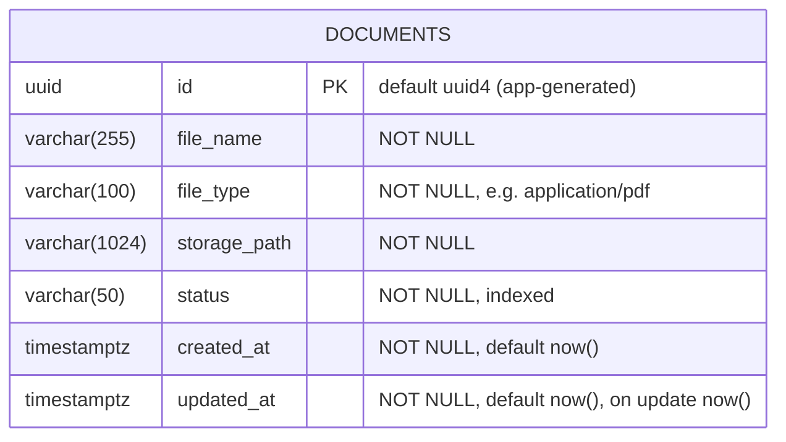

# Database Schema

## Entity Relationship Diagram



## Migrations

The schema is managed by Alembic (`migrations/`). The initial revision
`a7c60fb06eaa` creates the `documents` table. Constraint names follow the
naming convention in [`app/db/base.py`](../app/db/base.py).

```bash
task db-upgrade                       # apply all migrations
task db-revision MSG="describe change" # autogenerate a new revision
task db-check                         # fail if models and migrations differ
```

## Tables

### `documents`

Source: [`app/models/document.py`](../app/models/document.py)

| Column         | Type            | Constraints                 | Default / Behavior                       |
| -------------- | --------------- | --------------------------- | ---------------------------------------- |
| `id`           | `UUID`          | Primary key                 | `uuid4()` generated by the application   |
| `file_name`    | `VARCHAR(255)`  | `NOT NULL`                  |                                          |
| `file_type`    | `VARCHAR(100)`  | `NOT NULL`                  | MIME type or extension                   |
| `storage_path` | `VARCHAR(1024)` | `NOT NULL`                  | Location of the file in storage          |
| `status`       | `VARCHAR(50)`   | `NOT NULL`, indexed         | Processing state of the document         |
| `created_at`   | `TIMESTAMPTZ`   | `NOT NULL`                  | `now()` set by the database on insert    |
| `updated_at`   | `TIMESTAMPTZ`   | `NOT NULL`                  | `now()` on insert; SQLAlchemy sets `now()` on ORM updates |

`created_at` and `updated_at` come from `TimestampMixin` in [`app/models/base.py`](../app/models/base.py).

### Indexes

| Name                    | Column   |
| ----------------------- | -------- |
| `pk_documents`          | `id`     |
| `ix_documents_status`   | `status` |
