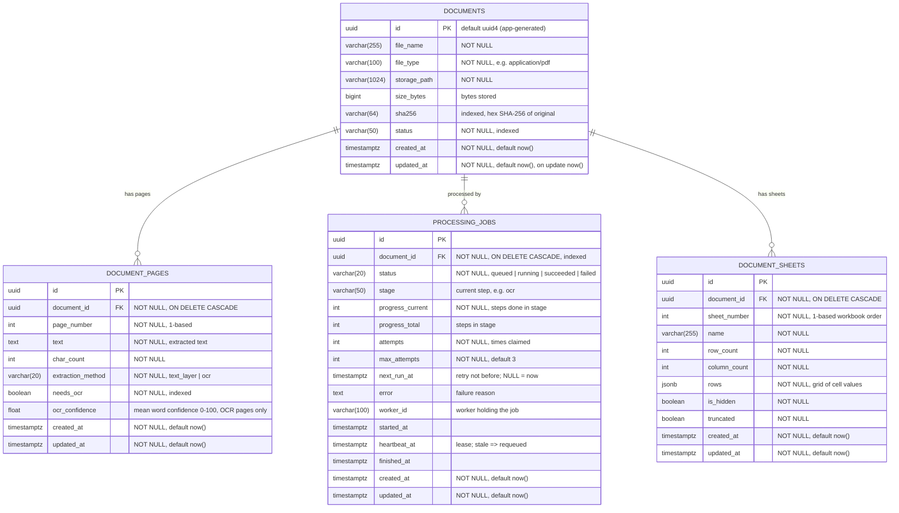

# Database Schema

## Entity Relationship Diagram



## Migrations

The schema is managed by Alembic (`migrations/`). The initial revision
`a7c60fb06eaa` creates the `documents` table; `b57b365d1cf4` adds
`size_bytes` and `sha256` (nullable only for rows uploaded before it). Constraint names follow the
naming convention in [`app/db/base.py`](../app/db/base.py).

```bash
task db-upgrade                       # apply all migrations
task db-revision MSG="describe change" # autogenerate a new revision
task db-check                         # fail if models and migrations differ
```

## Tables

### `documents`

Source: [`app/models/document.py`](../app/models/document.py)

| Column         | Type            | Constraints                 | Default / Behavior                       |
| -------------- | --------------- | --------------------------- | ---------------------------------------- |
| `id`           | `UUID`          | Primary key                 | `uuid4()` generated by the application   |
| `file_name`    | `VARCHAR(255)`  | `NOT NULL`                  |                                          |
| `file_type`    | `VARCHAR(100)`  | `NOT NULL`                  | MIME type or extension                   |
| `storage_path` | `VARCHAR(1024)` | `NOT NULL`                  | Location of the file in storage          |
| `size_bytes`   | `BIGINT`        | nullable                    | Size of the stored original in bytes     |
| `sha256`       | `VARCHAR(64)`   | nullable, indexed           | SHA-256 of the original, for integrity   |
| `status`       | `VARCHAR(50)`   | `NOT NULL`, indexed         | Processing state of the document         |
| `created_at`   | `TIMESTAMPTZ`   | `NOT NULL`                  | `now()` set by the database on insert    |
| `updated_at`   | `TIMESTAMPTZ`   | `NOT NULL`                  | `now()` on insert; SQLAlchemy sets `now()` on ORM updates |

`created_at` and `updated_at` come from `TimestampMixin` in [`app/models/base.py`](../app/models/base.py).

`status` moves through `uploaded` → `processing` → `processed` or `failed`.

### `document_pages`

Source: [`app/models/document_page.py`](../app/models/document_page.py)

One row per page of extracted text. `(document_id, page_number)` is unique;
deleting a document deletes its pages. Digital PDF pages use their text
layer (`extraction_method = text_layer`); scanned PDF pages and image frames
are OCRed with Tesseract (`ocr`) and record `ocr_confidence`. `needs_ocr`
marks a page still awaiting OCR.

### `document_sheets`

Source: [`app/models/document_sheet.py`](../app/models/document_sheet.py)

One row per worksheet of an XLSX/XLS workbook; a CSV file is stored as a
single sheet (named after the file) whose values are all strings. `rows` is a row-major JSONB
grid of scalars: numbers and booleans keep their type, dates are ISO 8601
strings, empty cells are `null`. Trailing empty rows/columns are trimmed;
gaps inside the data are kept. Sheets over 1,000,000 cells are cut off at a
row boundary and flagged `truncated`. `(document_id, sheet_number)` is
unique; deleting a document deletes its sheets.

### `processing_jobs`

Source: [`app/models/processing_job.py`](../app/models/processing_job.py)

Durable background work queue. Uploading a processable document inserts a
`queued` job in the same transaction. Worker processes (`python -m
app.worker`) claim the oldest queued job with `FOR UPDATE SKIP LOCKED`, set
it `running`, and write `stage` / `progress_current` / `progress_total` plus
`heartbeat_at` about once a second. A `running` job whose heartbeat is older
than `JOB_LEASE_SECONDS` (default 300) belonged to a dead worker and is put
back to `queued`; `attempts` counts each claim. Exposed via
`GET /documents/{id}/processing`.

Retries: a failed attempt goes back to `queued` with `next_run_at` set by
exponential backoff (`JOB_RETRY_BASE_SECONDS` × 2^(attempt−1), capped at
`JOB_RETRY_MAX_SECONDS`, ±20% jitter) and `error` holding the last failure,
until `attempts` reaches `max_attempts` (`JOB_MAX_ATTEMPTS`); then the job
and its document become `failed`. Permanent errors (original file missing,
no extractor) fail at once. A dead worker's job on its final attempt is
failed rather than requeued, so a crashing document cannot loop forever.
`POST /documents/{id}/processing/retry` adds a fresh job for a failed
document. The partial unique index `uq_processing_jobs_active_document`
allows at most one `queued`/`running` job per document.

### Indexes

| Name                    | Column   |
| ----------------------- | -------- |
| `pk_documents`          | `id`     |
| `ix_documents_status`   | `status` |
| `ix_documents_sha256`   | `sha256` |
| `pk_document_pages`     | `id`     |
| `uq_document_pages_document_id_page_number` | `document_id, page_number` |
| `ix_document_pages_needs_ocr` | `needs_ocr` |
| `pk_document_sheets`    | `id`     |
| `uq_document_sheets_document_id_sheet_number` | `document_id, sheet_number` |
| `pk_processing_jobs`    | `id`     |
| `ix_processing_jobs_document_id` | `document_id` |
| `ix_processing_jobs_status_created_at` | `status, created_at` (queue order) |
| `uq_processing_jobs_active_document` | `document_id` — unique, partial: `WHERE status IN ('queued','running')` |
