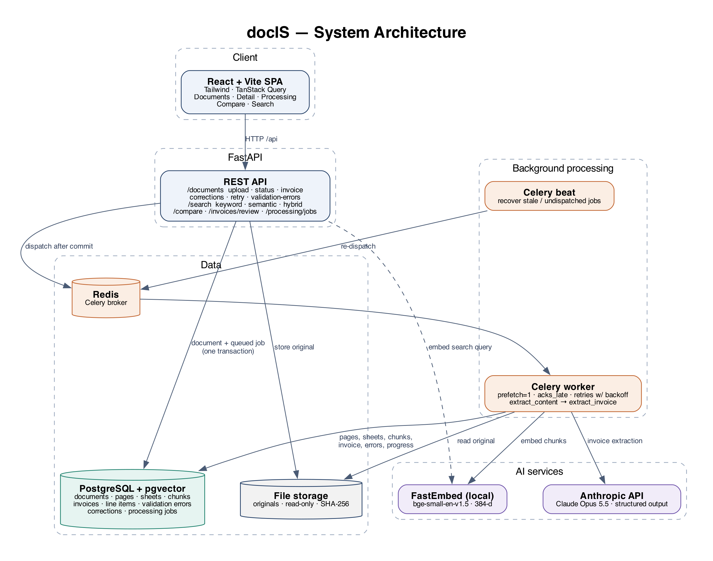
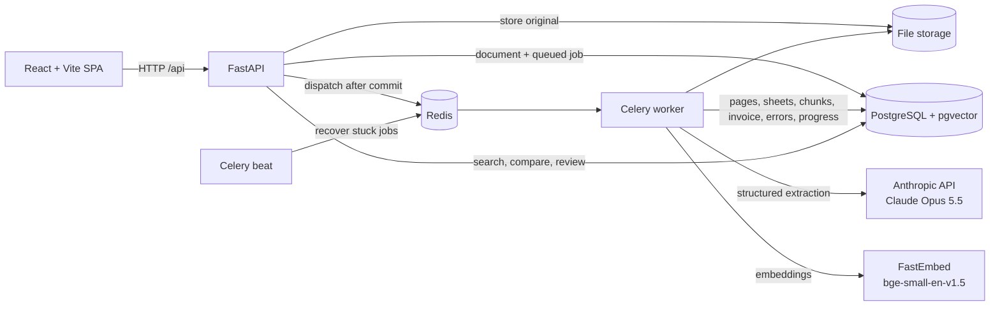
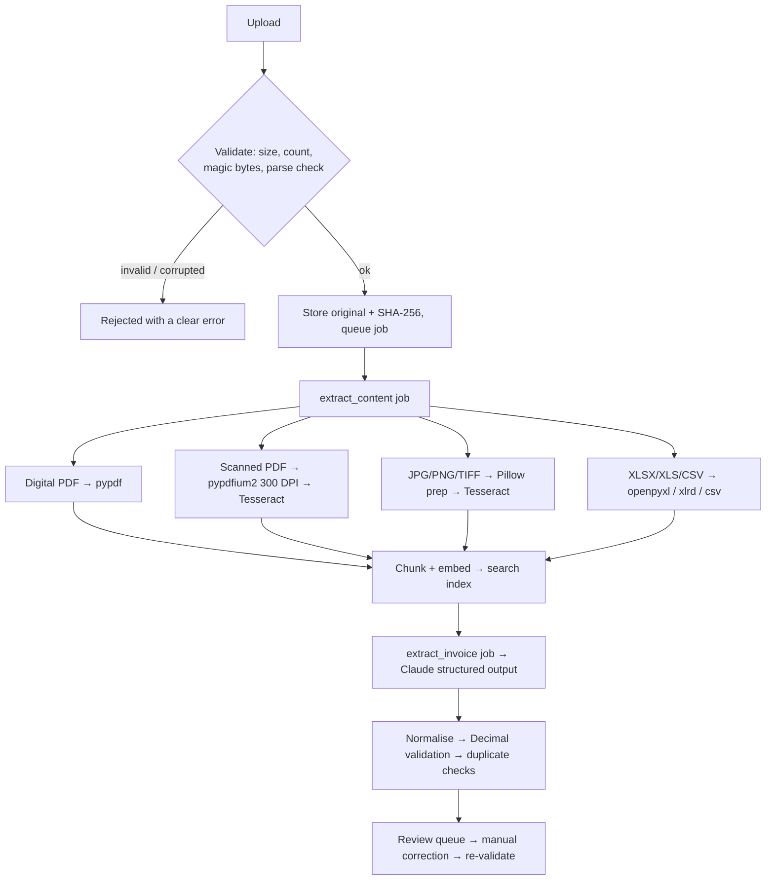
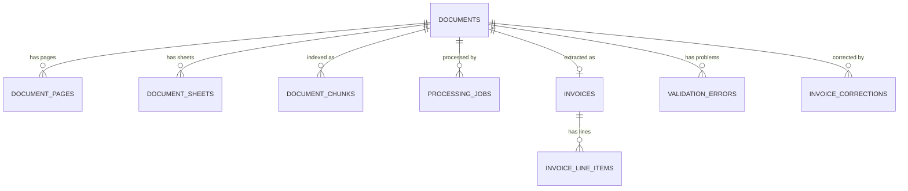

# AI Engineer Assignment Submission

**Project:** AI-Powered Document Intelligence System (docIS)
**Candidate:** Nazmul Alam Diptu
**Repository:** https://github.com/diptu/docIS
**Submission date:** 23 November 2026

## 1. Project Overview

docIS is an AI-powered document intelligence system. It automates the ingestion, processing, extraction, validation and retrieval of business documents.

It accepts PDF, JPG, PNG, TIFF, XLSX, XLS and CSV files. It combines:
- conventional text extraction
- OCR
- LLM-based invoice extraction
- deterministic financial validation
- hybrid search

Together these reduce manual data entry and make invoice processing more reliable.

The web interface lets users:
- upload many documents at once
- monitor processing progress
- inspect extracted information
- review validation issues
- correct extracted values
- compare documents
- search everything processed so far

### Requirement coverage

| Task | Requirement | Where it is implemented |
|---|---|---|
| 1 | PDF, JPG, PNG, TIFF, XLSX, XLS, CSV; multi-page; multiple sheets; poor quality; corrupted files | `app/services/file_types.py`, `app/processing/` |
| 2 | Invoice number, date, supplier, customer, subtotal, tax, total, currency, line items as JSON; no invented values | `app/extraction/llm.py`, `schema.py`, `normalize.py` |
| 3 | Missing fields, wrong numbers, duplicates, subtotal/tax/lines/total consistency; manual-review flags | `app/extraction/validation.py`, `review.py` |
| 4 | REST APIs for upload, status, results, search, corrections, reprocessing; background jobs | `app/api/routes/`, `app/worker/` |
| 5 | Metadata, text, structured results, validation errors, processing history; keyword + semantic search | `app/models/`, `app/search/` |
| 6 | React UI: upload, progress, inspect, review errors, correct, search | `frontend/src/pages/` |
| 7 | Automated tests + evaluation on a labelled dataset | `backend/tests/`, `frontend/src/**/*.test.tsx`, `backend/evaluation/` |
| Scenario | PDF↔PDF and PDF↔Excel cross-verification | `app/compare/`, `GET /compare` |

## 2. Submission Deliverables

### Deliverable 1 — Git Repository

Repository: https://github.com/diptu/docIS

The repository contains:
- the backend (FastAPI, Celery) and frontend (React, Vite) source code
- the document-processing pipelines
- database migrations
- automated tests
- the evaluation harness
- deployment configuration (`backend/compose.yaml`, `render.yaml`, `frontend/vercel.json`)
- documentation

### Deliverable 2 — README and Setup Instructions

[`README.md`](README.md) documents:
- Project overview, features and technology stack.
- Prerequisites, including Tesseract, Docker and an Anthropic API key.
- How to create and update `backend/.env`, with a table of the main variables and what to do after changing them.
- PostgreSQL + pgvector setup: Docker, native Homebrew/apt, or hosted; enabling the extension, migrations, verification and troubleshooting.
- Getting an Anthropic API key, checking it works, and handling it safely: secrecy, separate keys per environment, revoking, spend limits, and running without a key.
- One-command start with Docker Compose: database, migrations, API, Celery worker, Celery beat and Redis.
- Local development: `uv`, Alembic migrations, API, worker, beat, and the Vite frontend.
- The API reference (Swagger at `/docs`, ReDoc at `/redoc`) and a table of the main endpoints.
- Test and evaluation commands, with the latest results.

### Deliverable 3 — Architecture Diagram and Database Schema

The full documents are [`backend/docs/architecture.md`](backend/docs/architecture.md) and [`backend/docs/database_schema.md`](backend/docs/database_schema.md).

#### 3.1 High-level architecture

#### 3.2 Processing pipeline

#### 3.3 Database schema

| Table | Stores |
|---|---|
| `documents` | File metadata, storage path, SHA-256, status |
| `document_pages` | Extracted text per page, method (text layer / OCR), OCR confidence |
| `document_sheets` | Parsed spreadsheet grids (JSONB) per sheet |
| `document_chunks` | Search chunks: GIN full-text index + 384-d pgvector embedding (HNSW) |
| `processing_jobs` | Processing history: stage, progress, attempts, errors, heartbeat |
| `invoices`, `invoice_line_items` | Structured extraction results (exact `NUMERIC` amounts), model and token usage |
| `validation_errors` | Review issues with severity and resolved state |
| `invoice_corrections` | Audit trail of manual corrections (`{field: {old, new}}`) |

#### 3.4 Technology decisions

The assignment lets candidates choose alternatives to the suggested technologies. Each choice below was made on these criteria:
- the document-processing workload
- maintainability
- licensing
- operational complexity
- the five-day timeframe

**pypdf for digital PDFs**

I chose pypdf over PyMuPDF for these reasons:
- **Lightweight:** it is pure Python and sufficient for page-by-page text extraction.
- **Licensing:** pypdf is BSD-licensed. PyMuPDF is AGPL-3.0 or commercial, which adds licensing considerations for a deployed application.
- **Maintainability:** it integrates directly with the Python backend, with no separate PDF service.
- **Page-level processing:** it extracts text page by page, which fits the workflow.

Scanned pages have no usable text layer. Those pages are rendered at 300 DPI with pypdfium2 and read with Tesseract. This keeps digital extraction and OCR as separate operations.

*Trade-off:* PyMuPDF can be faster and handles complex layouts better. pypdf may not keep the reading order of complicated multi-column documents.

**PostgreSQL + pgvector**

- **Relational integrity:** documents, jobs, invoices, line items, validation errors and corrections have clear relationships.
- **Transactions:** an extraction, its line items and its review errors are committed together.
- **JSONB:** stores flexible data, such as spreadsheet grids and error details, alongside relational columns.
- **Built-in keyword search:** PostgreSQL full-text search provides stemming and ranking.
- **Vector search:** pgvector with an HNSW index provides semantic search without a separate vector database.
- **Job coordination:** row-level locking (`SELECT … FOR UPDATE`), partial unique indexes and atomic transactions keep processing jobs consistent.

*Trade-off:* at much larger scale, a dedicated vector database could scale independently, and vector and relational workloads may compete for resources.

**React, Vite and Tailwind CSS**

- **React:** suits the data-heavy screens:
  - document tables and filters
  - upload workflows and progress indicators
  - editable invoice forms
  - validation review
  - comparison tables
  - search results with highlighted snippets
- **Vite:** the app needs no server-side rendering or SEO, so it is built as static files.
  - Production bundle: **388.14 KB, or 115.84 KB gzipped**.
- **Tailwind CSS:** styles the interface without a large component library.
- **TanStack Query:** manages server state: caching, polling processing status, invalidating data after uploads and corrections, and loading and error states. Redux is not needed.

*Trade-off:* Tailwind markup can become verbose, so repeated patterns are extracted into reusable components.

**FastAPI instead of Node.js/NestJS**

The core workload is Python document processing and ML. It depends on:
- pypdf and pypdfium2
- pytesseract and Pillow
- openpyxl and xlrd
- FastEmbed
- the Anthropic Python SDK

With FastAPI, the API and the Celery workers share one language, one set of models and one set of services. FastAPI also provides:
- async request handling
- Pydantic validation
- dependency injection
- automatic OpenAPI documentation

NestJS would be a good choice for an all-TypeScript team. However, it would still need Python workers for OCR, spreadsheet parsing and embeddings, which adds cross-language contracts.

**Celery and Redis**

OCR, PDF rendering and LLM extraction take far longer than an API request should. Celery workers run them asynchronously, with Redis as the broker.

Job state is persisted in PostgreSQL rather than trusted to the queue:
- Jobs are claimed with row locks.
- Running jobs send heartbeats, and Celery beat requeues stale or undispatched jobs.
- Temporary failures retry with exponential backoff and jitter, up to 3 attempts by default.

**Overall**

The stack prioritises:
- Python compatibility for document and AI workloads.
- Relational consistency for financial data.
- One database for both relational and vector search.
- Background processing for long-running work.
- A lightweight static frontend.
- Open-source components where practical.

### Deliverable 4 — Working Backend API and Frontend

**Backend REST API** (FastAPI, OpenAPI at `/docs`):

| Capability | Endpoints |
|---|---|
| Upload (multiple files) | `POST /documents` |
| Processing status and history | `GET /documents/{id}/processing`, `GET /documents/{id}/processing/history`, `GET /processing/jobs` |
| Extracted results | `GET /documents/{id}/pages`, `/sheets`, `/invoice` |
| Validation errors and review | `GET /documents/{id}/validation-errors`, `PATCH …/{error_id}`, `GET /invoices/review` |
| Manual corrections | `PUT /documents/{id}/invoice`, `GET /documents/{id}/invoice/corrections` |
| Failed-job reprocessing | `POST /documents/{id}/processing/retry` |
| Search | `GET /search?mode=keyword\|semantic\|hybrid`; list filters on `GET /documents` |
| Comparison | `GET /compare` |

**Frontend** (React, Vite, Tailwind CSS):

| Page | Purpose |
|---|---|
| Documents (`/`) | Upload and manage documents |
| Document detail (`/documents/:id`) | Original file, extracted text/sheets, invoice form with corrections, validation errors, job and correction history |
| Processing (`/processing`) | Live job progress |
| Compare (`/compare`) | Multi-document comparison and PDF↔Excel reconciliation |
| Search (`/search`) | Keyword, semantic and hybrid search with highlighted snippets |

### Deliverable 5 — Document Processing Pipelines

Uploaded documents are validated and stored, then processed by background workers, so API requests are never blocked.

**1. Upload and file validation**
- Supports PDF, JPG, PNG, TIFF, XLSX, XLS and CSV.
- Checks file extensions against file signatures (magic bytes).
- Parses uploaded files to detect corrupted or invalid documents.
- Rejects empty files, oversized files and too many files per upload.
- Stores originals unchanged and read-only, and records a SHA-256 hash for integrity and duplicate detection.

**2. Background processing and job management**
- Celery workers with a Redis broker; job state is persisted in PostgreSQL.
- Tracks processing stage, progress and status.
- Retries temporary failures with exponential backoff, up to 3 attempts by default.
- Permanent failures stop immediately with a user-friendly message.
- Celery beat recovers interrupted or undispatched jobs.

**3. Content extraction and OCR**

| Input format | Processing approach |
|---|---|
| Digital PDF | Page-by-page text extraction with pypdf |
| Scanned PDF | Page rendering at 300 DPI with pypdfium2, then Tesseract OCR |
| JPG / PNG | Pillow preprocessing (EXIF orientation, transparency flattening, grayscale, upscaling small images), then Tesseract |
| TIFF | Multi-frame: each frame is OCRed as a page |
| XLSX / XLS | Every sheet parsed with openpyxl / xlrd (dates, booleans, errors and hidden sheets handled) |
| CSV | Delimiter and encoding detection with Python's `csv` module |

**4. Search indexing**
- Splits extracted content into overlapping chunks, each tied to its source page or sheet.
- Generates 384-dimensional embeddings with BAAI/bge-small-en-v1.5 through FastEmbed.
- Keyword search: PostgreSQL full-text search with a GIN index.
- Semantic search: pgvector with an HNSW cosine index.
- Hybrid search: combines both with reciprocal rank fusion.

**5. AI invoice extraction**

Claude Opus 5.5 (`claude-opus-5-5`, medium effort) is called through the Anthropic API with **structured output**, so the reply always matches the `InvoiceData` schema.

The extracted fields are:
- invoice number, invoice date, due date
- supplier (vendor) and customer details
- currency, subtotal, tax, total, amount due
- line items: description, code, quantity, unit price, tax rate, amount
- `is_invoice` classification and `uncertain_fields`

The prompt tells the model to copy values exactly as printed and to return `null` for anything not stated. Doubtful values are listed in `uncertain_fields` instead of being guessed.

**6. Financial validation and duplicate detection**

Deterministic checks using `Decimal` arithmetic:
- quantity × unit price = line amount
- Σ line amounts = subtotal
- tax consistency
- subtotal + tax = total
- amount due vs. total

Duplicate detection:
- byte-identical files (SHA-256)
- the same supplier and invoice number
- possible duplicates: the same supplier, date and total

Missing fields, failed checks, low OCR confidence, model-uncertain fields, non-invoices and duplicates are all recorded as validation errors. A document with any unresolved error appears in the review queue.

**7. Manual review and corrections**
- Users correct invoice fields in the UI.
- Each change is recorded as `{old, new}` in `invoice_corrections`.
- Corrected values are re-normalised, and validation and duplicate checks run again.

**8. Document-to-document comparison**
- **Invoice comparison:** header fields, totals and line items. Lines are matched by product code, then by description similarity.
- **Multi-document comparison:** two or more documents of any type, field by field.
- **Text comparison:** line-level diff of extracted text.
- **PDF/image ↔ Excel/CSV reconciliation:** checks whether each spreadsheet row's values appear in the PDF's extracted text, tolerating different number and date formats.

**9. Evaluation pipeline**

An offline harness, separate from the application:
- Generates synthetic labelled invoices: PDF, scanned PDF, TIFF, XLSX and CSV.
- Converts third-party labelled datasets into the standard ground-truth format.
- Measures:
  - field accuracy, exact-invoice accuracy and hallucination rate
  - line-item precision, recall and F1
  - success and failure rates by stage
  - timing and cost
- Injects known errors into ground-truth invoices to measure validation precision and recall.
- Writes JSON results and an HTML report.

### Deliverable 6 — Automated Tests and Test Results

**Backend** (pytest):
- Upload validation and file-type detection, including corrupted, empty, oversized and mismatched files.
- PDF text extraction, OCR (real Tesseract) and multi-frame TIFF.
- Spreadsheet parsing: XLSX, XLS and CSV.
- AI extraction: structured output, normalisation, and API failures such as credit, timeout and network errors, with the Anthropic API mocked.
- Financial validation and duplicate detection.
- Database operations against real PostgreSQL + pgvector, using the actual Alembic migrations.
- Background jobs: claiming, retries, backoff, recovery and heartbeats.
- Search (keyword, semantic, hybrid), comparison, corrections, API error handling, and end-to-end flows.

**Frontend** (Vitest + React Testing Library):
- Uploads and file limits.
- Document list and processing states.
- Invoice display and corrections.
- Search, comparison, empty states and API failures.

**Results** (final run, 22 November 2026):

| Suite | Collected | Passed | Failed | Skipped | Coverage | Time |
|---|---|---|---|---|---|---|
| Backend (pytest) | 696 | 696 | 0 | 0 | 99.74% | 37.59 s |
| Frontend (Vitest) | 89 tests in 15 files | 89 | 0 | 0 | n/a | 4.0 s |

The backend run includes the PostgreSQL integration tests (`TEST_POSTGRES_URL`) and the real embedding-model tests (`RUN_EMBEDDING_TESTS=1`). Without them, `uv run pytest` runs 674 tests and skips 22.

### Deliverable 7 — Evaluation Report

**Evaluation report:** https://claude.ai/artifact/9Gt91uQ692xuoSpcq5h7Me
The JSON results and HTML report can be regenerated with `task eval-3p-validate`, `task eval-3p` and `task eval-report`. They are written to `backend/evaluation/third_party_eval/results/`.

#### Dataset

There are 181 labelled third-party invoice documents (`backend/evaluation/third_party/`), converted to the standard ground-truth format. Each document has its own JSON file with the expected header fields, supplier name, totals and line items.

| Category | Docs | Category | Docs |
|---|---|---|---|
| Clean digital | 31 | Photographed | 45 |
| Credit notes | 10 | Scanned | 15 |
| Multi-currency | 19 | Tax layouts | 14 |
| Freight / surcharges | 16 | Hard layouts | 13 |
| Handwritten | 8 | Multi-page | 10 |

#### Methodology
- **Pipeline:** each document runs through the real pipeline: text extraction or OCR, then Claude Opus 5.5 (`claude-opus-5-5`, medium effort), then normalisation.
- **Field-level accuracy:** correct header fields ÷ labelled header fields. A field counts as correct only when its normalised value exactly matches the ground truth (dates and amounts are compared as values). A correct `null` counts as correct.
- **Exact invoice accuracy:** share of documents where every labelled field and every line item is correct.
- **Hallucination rate:** share of fields that are `null` in the ground truth but given a value by the model.
- **Success / failure rate:** a document fails if content extraction or AI extraction raises an error.
- **Processing time:** wall-clock time per document, content extraction plus AI extraction.
- **Validation precision / recall:** known errors are injected into ground-truth invoices (wrong totals, subtotals, tax and line sums). Each invoice is then scored on whether the deterministic checks flag it.

#### Measured results

| Metric | Actual result |
|---|---|
| Number of evaluated documents | 181 (179 extracted) |
| Field-level extraction accuracy | **87.5%** (1,363 / 1,557 fields) |
| Exact invoice accuracy | **65.9%** |
| Hallucination rate | **0.0%** |
| Line-item precision / recall / F1 | 98.7% / 96.8% / 97.7% |
| Average processing time | **10.31 s** (p95 32.29 s) |
| Median processing time | **7.01 s** |
| Document success rate | **98.9%** (179 / 181) |
| Document failure rate | **1.1%** (2 / 181) |
| Validation precision | **98.1%** |
| Validation recall | **99.7%** (100% of 860 injected errors detected; 9.5% false-alarm rate) |
| Cross-document reconciliation accuracy | Not evaluated (feature implemented in `app/compare/`, no labelled pairs) |
| API cost for the run | $4.62 |

**Results by category:**

| Category | Exact invoice | Field accuracy | Median time |
|---|---|---|---|
| Clean | 77.4% | 100% | 5.02 s |
| Freight | 100% | 100% | 5.70 s |
| Hard layouts | 100% | 100% | 5.38 s |
| Multi-page | 100% | 100% | 32.32 s |
| Scanned | 86.7% | 99.3% | 8.91 s |
| Tax layouts | 64.3% | 97.6% | 6.18 s |
| Multi-currency | 68.4% | 90.5% | 5.04 s |
| Photographed | 47.7% | 79.8% | 8.71 s |
| Handwritten | 0% | 51.4% | 11.04 s |
| Credit notes | 0% | 25.0% | 4.57 s |

**Failures:**
- `freight-trip-reference-2`: the network connection dropped during the API call (`ReadError`). In production this would be retried automatically.
- `photo-rotate-small-severe`: OCR found no text in a photo tilted about 10°.

#### Known limitations
- **Credit notes:**
  - 7 of 10 were classified `is_invoice = false`, because the schema defines an invoice as "requesting payment".
  - 3 had negative amounts where the ground truth is positive.
  - This is a definition mismatch rather than misreading.
- **Images:**
  - Handwritten and damaged photos cause OCR misreads.
  - OCR preprocessing does not straighten tilted images, which caused the one OCR failure.
- **Multi-currency invoices:** the model sometimes picks the foreign currency.
- **Validation false alarms:** the arithmetic checks raise false alarms (9.5%), mostly on the `total` check for invoices with credits, freight or surcharges.
- **Review flags on real extractions:** flags raised on the model's actual output are noisier than in the injected-error test. They caught 5 of 7 documents that should have been flagged, with 39 false alarms out of 177 (11.4% precision).
- **Not measured:**
  - customer name (the third-party labels don't include it)
  - cross-document reconciliation
  - the synthetic dataset, which has only been run with the oracle harness check, not with Claude
- **Long documents:** invoice extraction is a single LLM call capped at 600,000 characters (`LLM_MAX_INPUT_CHARS`). Longer documents are still text-extracted and searchable, but invoice extraction reports an error.

### Deliverable 8 — Recorded Application Walkthrough

The recording covers:
- Project introduction and architecture.
- Dashboard and document overview.
- Uploading each supported format: PDF, scanned PDF, image, TIFF, XLSX, XLS, CSV.
- Processing and status monitoring.
- AI invoice extraction results.
- Validation errors, manual corrections and correction history.
- Document comparison and PDF↔Excel reconciliation.
- Keyword, semantic and hybrid search.
- Database schema and evaluation results.

**Walkthrough recording:** _TODO: add the video link before submitting._

### Deliverable 9 — AI Prompts and Development Disclosure

#### Disclosure

AI assistance was used throughout development.

**Tools:**
- **Claude desktop:** design discussion and prompt drafting.
- **Claude Code** (Anthropic's coding agent, running Claude Opus 5.5): implementation, refactoring, tests, debugging, the evaluation harness, running evaluations, generating the report, and documentation.

**Who did what:**
- **Me:** I set the architecture and requirements, chose the technologies, reviewed the generated code, and decided what to accept.
- **AI:** wrote and edited code, tests and documentation on request. It also ran the test suites and the evaluation, and reported the measured numbers.

**Measured results:** all test results and evaluation metrics in this document come from actual runs (22 November 2026). None are estimated.

**AI inside the product:** the application itself uses Claude Opus 5.5 through the Anthropic API for invoice extraction. Embeddings come from the open-source FastEmbed model (BAAI/bge-small-en-v1.5), which runs locally.

#### Representative development prompts

The prompts below are rewritten for clarity, keeping the intent of the original requests. They are representative examples, not an exhaustive record.

1. **Frontend implementation:** Implement a responsive document intelligence frontend using React, Vite and Tailwind CSS. Build reusable components and pages for uploads, the document list, processing status, invoice inspection, validation review, manual corrections and search. Follow a consistent design system, provide loading and empty states, and handle API errors gracefully.

2. **Backend error handling:** Review the FastAPI backend and improve error handling across document processing, database operations and the external AI API. Handle server errors, database unavailability, failed extraction and insufficient API credit with meaningful HTTP responses and user-friendly messages. Do not expose internal exception details or sensitive information.

3. **Frontend tests:** Write tests with React Testing Library for uploads, file validation, the document list, processing states, invoice display, corrections, search, empty states and API failures. Test observable user behaviour, not implementation details.

4. **Backend tests:** Write pytest tests for upload validation, PDF extraction, OCR, spreadsheet parsing, AI extraction responses, financial validation, database operations, background processing, search, corrections and failure scenarios. Mock external AI calls and use an isolated test database for integration tests.

5. **TIFF support:** Extend the pipeline to support TIFF files in file validation, image preprocessing, OCR and ingestion. Keep PDF, JPG, PNG, XLSX, XLS and CSV working, and add tests for TIFF and invalid inputs.

6. **Evaluation structure:** Organise the evaluation directory into a reproducible structure. Store source documents, ground truth and validation expectations separately, name ground-truth files after their invoice identifiers, and keep separate JSON results for extraction, validation and reconciliation.

7. **Third-party dataset:** Write a converter for the datasets in `backend/evaluation/third_party/` that produces the standard ground-truth format, keeping fields, line items, amounts and document references. Add tasks to run the evaluation. Handle missing or ambiguous annotations without inventing ground-truth values.

8. **Evaluation report:** Generate an HTML report from the actual result files. Cover dataset composition, field and exact-invoice accuracy, validation precision and recall, reconciliation, processing time, and success and failure rates. Explain the methodology and separate measured results from unavailable metrics. Do not fabricate figures.

9. **Multi-document comparison:** Let users select two or more processed documents of any type and compare their extracted content. Normalise equivalent fields, and mark values as matching, mismatching, missing or unavailable, including line items, quantities, unit prices, tax and totals. Use deterministic rules and `Decimal` arithmetic, reuse existing pipelines, avoid new dependencies, and add backend and frontend tests. Run the tests and report the actual results.

10. **Usability improvements:** Improve empty states and error handling in the document interface. Show clear messages when there are no documents or results, and actionable messages for HTTP 500 errors, database outages and insufficient AI credits. Keep diagnostic detail in server logs only.

11. **Real evaluation run:** Run the extraction evaluation for real with Claude on all 181 third-party documents, rerun it after the API credit ran out, and update the reported numbers. Investigate the causes of failed and incorrect extractions.

12. **Submission review:** Analyse the assignment brief against the implementation, check every requirement, suggest improvements, and verify that this deliverables document contains everything required. Then fix the deliverables, README, architecture diagrams, database schema, evaluation results and AI disclosure.

## 3. Security, Performance and Scalability

**Security measures in place:**
- Uploads are checked by file signature (magic bytes), not just extension. Files are parsed to reject corrupted content, and size and count limits are enforced, including a request-size middleware.
- Originals are stored unchanged, read-only and atomically, with SHA-256 integrity checks. Storage paths come from a generated UUID, never the uploaded file name.
- All input is validated by Pydantic. Database access goes through SQLAlchemy with bound parameters.
- Error responses never expose stack traces or internal details. Diagnostics go to server logs only.
- Secrets come only from environment variables; `.env` is gitignored.
- In the deployment configs, Redis listens only on localhost (Compose), and Postgres and Redis are on Render's private network.
- The frontend sends `X-Content-Type-Options: nosniff` and a strict `Referrer-Policy`.

**Not yet implemented:**
- authentication and authorisation (every user can see and change all documents)
- rate limiting

These would be the first additions before production use.

**Performance and scalability:**
- The API is stateless, and all heavy work runs in Celery workers.
- Workers scale horizontally. Each reserves one task at a time (`prefetch=1`), and tasks are acknowledged late, so a crashed worker's task is redelivered.
- Job state in PostgreSQL makes processing recoverable after crashes.
- Search uses GIN and HNSW indexes.
- The production frontend bundle is 115.84 KB gzipped.
- Measured median processing time is 7.0 s per document, almost all of it the LLM call. Text extraction and OCR take a median of 0.02 s.
