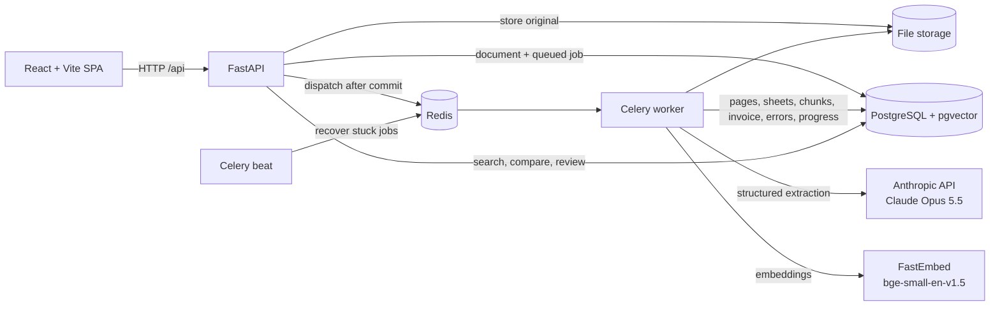
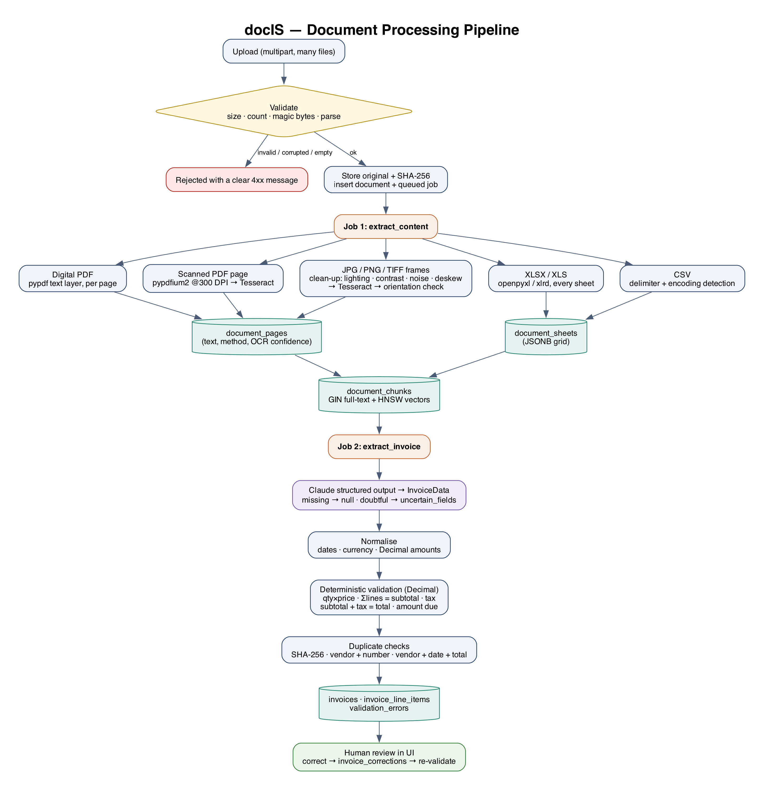
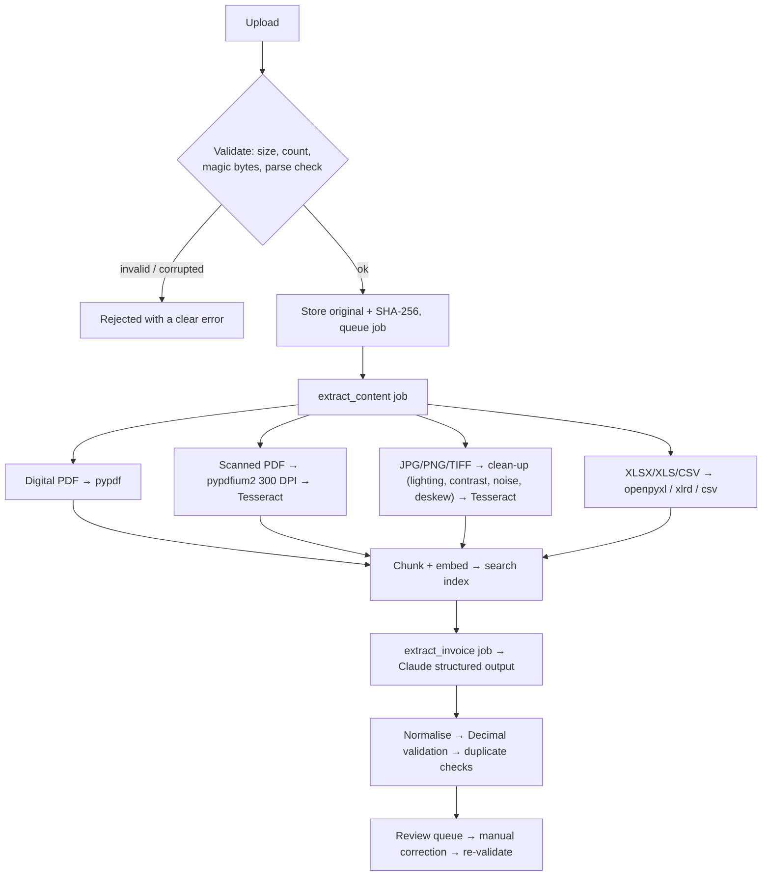
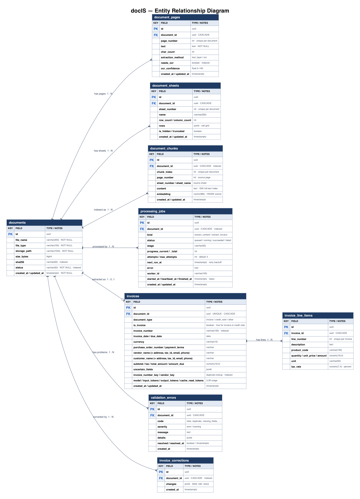
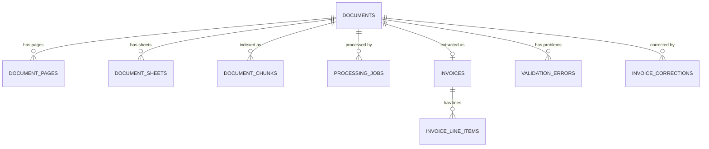

# AI Engineer Assignment Submission

**Project:** AI-Powered Document Intelligence System (docIS)
**Candidate:** Nazmul Alam Diptu
**Repository:** https://github.com/diptu/docIS
**Submission date:** 23 November 2026

## 1. Project Overview

docIS is an AI-powered document intelligence system. It automates the ingestion, processing, extraction, validation and retrieval of business documents.

It accepts PDF, JPG, PNG, TIFF, XLSX, XLS and CSV files. It combines:
- conventional text extraction
- OCR
- LLM-based invoice extraction
- deterministic financial validation
- hybrid search

Together these reduce manual data entry and make invoice processing more reliable.

The web interface lets users:
- upload many documents at once
- monitor processing progress
- inspect extracted information
- review validation issues
- correct extracted values
- compare documents
- search everything processed so far

### Requirement coverage

| Task | Requirement | Where it is implemented |
|---|---|---|
| 1 | PDF, JPG, PNG, TIFF, XLSX, XLS, CSV; multi-page; multiple sheets; poor quality; corrupted files | [`backend/app/services/file_types.py`](https://github.com/diptu/docIS/blob/main/backend/app/services/file_types.py), [`backend/app/services/validators.py`](https://github.com/diptu/docIS/blob/main/backend/app/services/validators.py), [`backend/app/processing/`](https://github.com/diptu/docIS/tree/main/backend/app/processing) (OCR: [`ocr.py`](https://github.com/diptu/docIS/blob/main/backend/app/processing/ocr.py), [`image_prep.py`](https://github.com/diptu/docIS/blob/main/backend/app/processing/image_prep.py); sheets: [`spreadsheets.py`](https://github.com/diptu/docIS/blob/main/backend/app/processing/spreadsheets.py)) |
| 2 | Invoice number, date, supplier, customer, subtotal, tax, total, currency, line items as JSON; no invented values | [`backend/app/extraction/llm.py`](https://github.com/diptu/docIS/blob/main/backend/app/extraction/llm.py), [`schema.py`](https://github.com/diptu/docIS/blob/main/backend/app/extraction/schema.py), [`normalize.py`](https://github.com/diptu/docIS/blob/main/backend/app/extraction/normalize.py), [`chunked.py`](https://github.com/diptu/docIS/blob/main/backend/app/extraction/chunked.py) |
| 3 | Missing fields, wrong numbers, duplicates, subtotal/tax/lines/total consistency; manual-review flags | [`backend/app/extraction/validation.py`](https://github.com/diptu/docIS/blob/main/backend/app/extraction/validation.py), [`review.py`](https://github.com/diptu/docIS/blob/main/backend/app/extraction/review.py) |
| 4 | REST APIs for upload, status, results, search, corrections, reprocessing; background jobs | [`backend/app/api/routes/`](https://github.com/diptu/docIS/tree/main/backend/app/api/routes), [`backend/app/worker/`](https://github.com/diptu/docIS/tree/main/backend/app/worker) |
| 5 | Metadata, text, structured results, validation errors, processing history; keyword + semantic search | [`backend/app/models/`](https://github.com/diptu/docIS/tree/main/backend/app/models), [`backend/migrations/`](https://github.com/diptu/docIS/tree/main/backend/migrations), [`backend/app/search/`](https://github.com/diptu/docIS/tree/main/backend/app/search) |
| 6 | React UI: upload, progress, inspect, review errors, correct, search | [`frontend/src/pages/`](https://github.com/diptu/docIS/tree/main/frontend/src/pages) |
| 7 | Automated tests + evaluation on a labelled dataset | [`backend/tests/`](https://github.com/diptu/docIS/tree/main/backend/tests), frontend tests (`*.test.tsx` files) in [`frontend/src/`](https://github.com/diptu/docIS/tree/main/frontend/src), [`backend/evaluation/`](https://github.com/diptu/docIS/tree/main/backend/evaluation) |
| Scenario | PDF↔PDF and PDF↔Excel cross-verification | [`backend/app/compare/`](https://github.com/diptu/docIS/tree/main/backend/app/compare), [`backend/app/api/routes/compare.py`](https://github.com/diptu/docIS/blob/main/backend/app/api/routes/compare.py) (`GET /compare`) |

## 2. Submission Deliverables

### Deliverable 1 — Git Repository

Repository: https://github.com/diptu/docIS

The repository contains:
- the backend (FastAPI, Celery) and frontend (React, Vite) source code
- the document-processing pipelines
- database migrations
- automated tests
- the evaluation harness
- deployment configuration (`backend/compose.yaml`, `render.yaml`, `frontend/vercel.json`, and `deploy/` for running the published images)

Docker images: https://hub.docker.com/r/diptu/docis/tags (`backend`, `frontend` and `db`, for `linux/amd64` and `linux/arm64`).
- documentation

### Deliverable 2 — README and Setup Instructions

[`README.md`](https://github.com/diptu/docIS/blob/main/README.md) documents:

- Project overview, features and technology stack.
- A quick start for Ubuntu from the Docker Hub images: install Docker, download one compose file, put the Anthropic API key in `.env`, and run `docker compose up -d`. PostgreSQL with pgvector, Redis and the database tables are set up automatically; no source code needed.
- Prerequisites, including Tesseract, Docker and an Anthropic API key.
- How to create and update `backend/.env`, with a table of the main variables and what to do after changing them.
- PostgreSQL + pgvector setup: Docker, native Homebrew/apt, or hosted; enabling the extension, migrations, verification and troubleshooting.
- Getting an Anthropic API key, checking it works, and handling it safely: secrecy, separate keys per environment, revoking, spend limits, and running without a key.
- One-command start with Docker Compose: database, migrations, API, Celery worker, Celery beat and Redis.
- Local development: `uv`, Alembic migrations, API, worker, beat, and the Vite frontend.
- The API reference (Swagger at `/docs`, ReDoc at `/redoc`) and a table of the main endpoints.
- Test and evaluation commands, with the latest results.

### Deliverable 3 — Architecture Diagram and Database Schema

The full documents are [`backend/docs/architecture.md`](https://github.com/diptu/docIS/blob/main/backend/docs/architecture.md) and [`backend/docs/database_schema.md`](https://github.com/diptu/docIS/blob/main/backend/docs/database_schema.md). All diagrams and their sources are in [`backend/docs/`](https://github.com/diptu/docIS/tree/main/backend/docs). [`pipeline_infographic.html`](https://github.com/diptu/docIS/blob/main/pipeline_infographic.html), in the repository root, shows how each file type (PDF, image, spreadsheet) travels from upload to a validated invoice. It is a standalone page: download it and open it in any browser.

#### 3.1 High-level architecture

Diagram: [`backend/docs/system_architecture.png`](https://github.com/diptu/docIS/blob/main/backend/docs/system_architecture.png) · Graphviz source: [`system_architecture.dot`](https://github.com/diptu/docIS/blob/main/backend/docs/system_architecture.dot)

#### 3.2 Processing pipeline

Diagram: [`backend/docs/processing_pipeline.png`](https://github.com/diptu/docIS/blob/main/backend/docs/processing_pipeline.png) · Graphviz source: [`processing_pipeline.dot`](https://github.com/diptu/docIS/blob/main/backend/docs/processing_pipeline.dot) · Code: [`backend/app/processing/`](https://github.com/diptu/docIS/tree/main/backend/app/processing), [`backend/app/worker/`](https://github.com/diptu/docIS/tree/main/backend/app/worker)

#### 3.3 Database schema

Diagram: [`backend/docs/database_schema.png`](https://github.com/diptu/docIS/blob/main/backend/docs/database_schema.png) · Graphviz source: [`database_schema.dot`](https://github.com/diptu/docIS/blob/main/backend/docs/database_schema.dot) · Migrations: [`backend/migrations/versions/`](https://github.com/diptu/docIS/tree/main/backend/migrations/versions)

| Table | Stores | Defined in |
|---|---|---|
| `documents` | File metadata, storage path, SHA-256, status | [`document.py`](https://github.com/diptu/docIS/blob/main/backend/app/models/document.py) |
| `document_pages` | Extracted text per page, method (text layer / OCR), OCR confidence | [`document_page.py`](https://github.com/diptu/docIS/blob/main/backend/app/models/document_page.py) |
| `document_sheets` | Parsed spreadsheet grids (JSONB) per sheet | [`document_sheet.py`](https://github.com/diptu/docIS/blob/main/backend/app/models/document_sheet.py) |
| `document_chunks` | Search chunks: GIN full-text index + 384-d pgvector embedding (HNSW) | [`document_chunk.py`](https://github.com/diptu/docIS/blob/main/backend/app/models/document_chunk.py) |
| `processing_jobs` | Processing history: stage, progress, attempts, errors, heartbeat | [`processing_job.py`](https://github.com/diptu/docIS/blob/main/backend/app/models/processing_job.py) |
| `invoices`, `invoice_line_items` | Structured extraction results (exact `NUMERIC` amounts), model and token usage | [`invoice.py`](https://github.com/diptu/docIS/blob/main/backend/app/models/invoice.py) |
| `validation_errors` | Review issues with severity and resolved state | [`invoice.py`](https://github.com/diptu/docIS/blob/main/backend/app/models/invoice.py) |
| `invoice_corrections` | Audit trail of manual corrections (`{field: {old, new}}`) | [`invoice.py`](https://github.com/diptu/docIS/blob/main/backend/app/models/invoice.py) |

All models are in [`backend/app/models/`](https://github.com/diptu/docIS/tree/main/backend/app/models).

#### 3.4 Technology decisions

The assignment lets candidates choose alternatives to the suggested technologies. Each choice below was made on these criteria:
- the document-processing workload
- maintainability
- licensing
- operational complexity
- the five-day timeframe

**pypdf for digital PDFs**

I chose pypdf over PyMuPDF for these reasons:
- **Lightweight:** it is pure Python and sufficient for page-by-page text extraction.
- **Licensing:** pypdf is BSD-licensed. PyMuPDF is AGPL-3.0 or commercial, which adds licensing considerations for a deployed application.
- **Maintainability:** it integrates directly with the Python backend, with no separate PDF service.
- **Page-level processing:** it extracts text page by page, which fits the workflow.

Scanned pages have no usable text layer. Those pages are rendered at 300 DPI with pypdfium2 and read with Tesseract. This keeps digital extraction and OCR as separate operations.

*Trade-off:* PyMuPDF can be faster and handles complex layouts better. pypdf may not keep the reading order of complicated multi-column documents.

**PostgreSQL + pgvector**

- **Relational integrity:** documents, jobs, invoices, line items, validation errors and corrections have clear relationships.
- **Transactions:** an extraction, its line items and its review errors are committed together.
- **JSONB:** stores flexible data, such as spreadsheet grids and error details, alongside relational columns.
- **Built-in keyword search:** PostgreSQL full-text search provides stemming and ranking.
- **Vector search:** pgvector with an HNSW index provides semantic search without a separate vector database.
- **Job coordination:** row-level locking (`SELECT … FOR UPDATE`), partial unique indexes and atomic transactions keep processing jobs consistent.

*Trade-off:* at much larger scale, a dedicated vector database could scale independently, and vector and relational workloads may compete for resources.

**React, Vite and Tailwind CSS**

- **React:** suits the data-heavy screens:
  - document tables and filters
  - upload workflows and progress indicators
  - editable invoice forms
  - validation review
  - comparison tables
  - search results with highlighted snippets
- **Vite:** the app needs no server-side rendering or SEO, so it is built as static files.
  - Production bundle: **388.14 KB, or 115.84 KB gzipped**.
- **Tailwind CSS:** styles the interface without a large component library.
- **TanStack Query:** manages server state: caching, polling processing status, invalidating data after uploads and corrections, and loading and error states. Redux is not needed.

*Trade-off:* Tailwind markup can become verbose, so repeated patterns are extracted into reusable components.

**FastAPI instead of Node.js/NestJS**

The core workload is Python document processing and ML. It depends on:
- pypdf and pypdfium2
- pytesseract and Pillow
- openpyxl and xlrd
- FastEmbed
- the Anthropic Python SDK

With FastAPI, the API and the Celery workers share one language, one set of models and one set of services. FastAPI also provides:
- async request handling
- Pydantic validation
- dependency injection
- automatic OpenAPI documentation

NestJS would be a good choice for an all-TypeScript team. However, it would still need Python workers for OCR, spreadsheet parsing and embeddings, which adds cross-language contracts.

**Celery and Redis**

OCR, PDF rendering and LLM extraction take far longer than an API request should. Celery workers run them asynchronously, with Redis as the broker.

Job state is persisted in PostgreSQL rather than trusted to the queue:
- Jobs are claimed with row locks.
- Running jobs send heartbeats, and Celery beat requeues stale or undispatched jobs.
- Temporary failures retry with exponential backoff and jitter, up to 3 attempts by default.

**Overall**

The stack prioritises:
- Python compatibility for document and AI workloads.
- Relational consistency for financial data.
- One database for both relational and vector search.
- Background processing for long-running work.
- A lightweight static frontend.
- Open-source components where practical.

### Deliverable 4 — Working Backend API and Frontend

**Backend REST API** (FastAPI, OpenAPI at `/docs`):

| Capability | Endpoints |
|---|---|
| Upload (multiple files) | `POST /documents` |
| Processing status and history | `GET /documents/{id}/processing`, `GET /documents/{id}/processing/history`, `GET /processing/jobs` |
| Extracted results | `GET /documents/{id}/pages`, `/sheets`, `/invoice` |
| Validation errors and review | `GET /documents/{id}/validation-errors`, `PATCH …/{error_id}`, `GET /invoices/review` |
| Manual corrections | `PUT /documents/{id}/invoice`, `GET /documents/{id}/invoice/corrections` |
| Failed-job reprocessing | `POST /documents/{id}/processing/retry` |
| Search | `GET /search?mode=keyword\|semantic\|hybrid`; list filters on `GET /documents` |
| Comparison | `GET /compare` |

**Frontend** (React, Vite, Tailwind CSS):

| Page | Purpose |
|---|---|
| Documents (`/`) | Upload and manage documents |
| Document detail (`/documents/:id`) | Original file, extracted text/sheets, invoice form with corrections, validation errors, job and correction history |
| Processing (`/processing`) | Live job progress |
| Compare (`/compare`) | Multi-document comparison and PDF↔Excel reconciliation |
| Search (`/search`) | Keyword, semantic and hybrid search with highlighted snippets |

### Deliverable 5 — Document Processing Pipelines

Uploaded documents are validated and stored, then processed by background workers, so API requests are never blocked.

**1. Upload and file validation**
- Supports PDF, JPG, PNG, TIFF, XLSX, XLS and CSV.
- Checks file extensions against file signatures (magic bytes).
- Parses uploaded files to detect corrupted or invalid documents.
- Rejects empty files, oversized files and too many files per upload.
- Stores originals unchanged and read-only, and records a SHA-256 hash used for duplicate detection.

**2. Background processing and job management**
- Celery workers with a Redis broker; job state is persisted in PostgreSQL.
- Tracks processing stage, progress and status.
- Retries temporary failures with exponential backoff, up to 3 attempts by default.
- Permanent failures stop immediately with a user-friendly message.
- Celery beat recovers interrupted or undispatched jobs.

**3. Content extraction and OCR**

| Input format | Processing approach |
|---|---|
| Digital PDF | Page-by-page text extraction with pypdf |
| Scanned PDF | Page rendering at 300 DPI with pypdfium2, then Tesseract OCR |
| JPG / PNG | Image clean-up (`app/processing/image_prep.py`), then Tesseract. See *Image clean-up* below. |
| TIFF | Multi-frame: each frame is OCRed as a page |
| XLSX / XLS | Every sheet parsed with openpyxl / xlrd (dates, booleans, errors and hidden sheets handled) |
| CSV | Delimiter and encoding detection with Python's `csv` module |

**Image clean-up before OCR**

Applies to photos, scanned PDF pages and TIFF frames. Each step measures the image first and only changes it when needed, so clean scans pass through untouched.
- **Basics:** EXIF orientation, a white background for transparent images, grayscale, and enlarging small images.
- **Illumination and contrast:** estimates the paper's brightness across the page and divides it out, which removes shadows and lifts dark photos. It then stretches the contrast.
- **Noise reduction:** a 3×3 median filter, applied only to grainy images that are about to be brightened. On noisy white scans, Tesseract measurably read better without it, because the filter erodes thin strokes and decimal points.
- **Deskewing:** finds the text angle within ±15° by testing angles and keeping the one where text rows line up best, then rotates to level.
- **Orientation:** when a first read has low confidence, Tesseract's orientation detection (OSD) checks for a sideways or upside-down page. The page is turned upright and read again, and the better of the two reads is kept.

**4. Search indexing**
- Splits extracted content into overlapping chunks, each tied to its source page or sheet.
- Generates 384-dimensional embeddings with BAAI/bge-small-en-v1.5 through FastEmbed.
- Keyword search: PostgreSQL full-text search with a GIN index.
- Semantic search: pgvector with an HNSW cosine index.
- Hybrid search: combines both with reciprocal rank fusion.

**5. AI invoice extraction**

Claude Opus 5.5 (`claude-opus-5-5`, medium effort) is called through the Anthropic API with **structured output**, so the reply always matches the `InvoiceData` schema.

The extracted fields are:
- invoice number, invoice date, due date
- supplier (vendor) and customer details
- currency, subtotal, tax, total, amount due
- line items: description, code, quantity, unit price, tax rate, amount
- `document_type` (`invoice`, `credit_note` or `other`), `is_invoice` (true for invoices and credit notes) and `uncertain_fields`

The prompt tells the model to copy values exactly as printed and to return `null` for anything not stated. Doubtful values are listed in `uncertain_fields` instead of being guessed.

**Credit notes and amount signs.** Credit notes, credit memos and debit notes are billing documents, extracted in full like invoices.
- **Sign convention** (the same one UBL uses): amounts are positive magnitudes in the document's own direction, and `document_type` gives the direction. A credit note for 100.00 is stored as `total_amount = 100.00`, whether printed as `-100.00`, `(100.00)` or `100.00 CR`. To post it to a ledger, negate it.
- **Negative values** appear only on itemised lines that run against the document: a discount line on an invoice, or a restocking fee on a credit note. Adjustments printed below the subtotal, such as a credit applied or a payment received, are not line items.
- **Enforcement:** normalisation applies the convention even when the model returns a credit note's amounts negative, keeping each line's quantity × unit price consistent with its amount.
- **Duplicates:** matching only compares documents of the same type, so a credit note that reverses an invoice is not flagged as its duplicate.

**Long documents**

A document that fits one request (about 50,000 characters, roughly 30–50 pages) is extracted in one call. A longer one is handled in `app/extraction/chunked.py`:
- **Splitting:** it is split into parts between pages and sheets. A page is cut inside only when it alone is too long. A long sheet repeats its heading row in every part.
- **Extraction:** parts are extracted four at a time, each told which part it is ("Part 2 of 7 of one document", outside the document tags).
- **Merging into one invoice:**
  - The document type comes from the first part that is a billing document.
  - Header fields and parties come from the first part that states them. Values that differ between parts are flagged as uncertain for review.
  - Line items from every part are kept in document order.
  - Totals come from the last part that states them.
  - Each part follows the credit-note sign convention before merging.
- **Overflow:** a part whose answer hits the output-token limit is halved and retried, up to three times.
- **Failure:** if any other part fails, the rest are cancelled and the job retries as a whole.
- **Cost guard:** a document needing more than 120 parts fails.
- **Evaluation:** the evaluation uses the same code path. `--chunk-chars` forces splitting on short documents for testing.

Measured with Claude on the 10 multi-page invoices (2–8 pages):

| Run | Invoices fully correct | Median time per invoice | Cost |
|---|---|---|---|
| One request per invoice (current code) | 10 of 10 | 34.6 s | $1.14 |
| One page per part (2–8 parts per invoice, merged) | 7 of 7 completed are exact; 3 not run (API credit ran out) | 11.6 s | $0.66 for 7 |
| Parts of 1,200 characters (pages cut mid-table) | 5 of 10 | — | $1.48 |

- **Whole pages merge correctly:** splitting at page boundaries reproduced the single-request result on every invoice that ran, and was about 3× faster because parts run in parallel.
- **Cutting inside a page is the weak case:** cuts in the middle of a page separated four line amounts from their rows. The production default only cuts inside a page longer than 50,000 characters.

**6. Financial validation and duplicate detection**

Deterministic checks using `Decimal` arithmetic:
- quantity × unit price = line amount
- Σ line amounts = subtotal
- tax consistency
- subtotal + tax = total
- amount due vs. total

Duplicate detection:
- byte-identical files (SHA-256)
- the same supplier and invoice number
- possible duplicates: the same supplier, date and total

Missing fields, failed checks, low OCR confidence, model-uncertain fields, non-invoices and duplicates are all recorded as validation errors. A document with any unresolved error appears in the review queue.

**7. Manual review and corrections**
- Users correct invoice fields in the UI.
- Each change is recorded as `{old, new}` in `invoice_corrections`.
- Corrected values are re-normalised, and validation and duplicate checks run again.

**8. Document-to-document comparison**
- **Invoice comparison:** header fields, totals and line items. Lines are matched by product code, then by description similarity.
- **Multi-document comparison:** two or more documents of any type, field by field.
- **Text comparison:** line-level diff of extracted text.
- **PDF/image ↔ Excel/CSV reconciliation:** checks whether each spreadsheet row's values appear in the PDF's extracted text, tolerating different number and date formats.

**9. Evaluation pipeline**

An offline harness, separate from the application:
- Generates synthetic labelled invoices: PDF, scanned PDF, TIFF, XLSX and CSV.
- Converts third-party labelled datasets into the standard ground-truth format.
- Measures:
  - field accuracy, exact-invoice accuracy and hallucination rate
  - line-item precision, recall and F1
  - success and failure rates by stage
  - timing and cost
- Injects known errors into ground-truth invoices to measure validation precision and recall.
- Writes JSON results and an HTML report.

### Deliverable 6 — Automated Tests and Test Results

**Backend** (pytest):
- Upload validation and file-type detection, including corrupted, empty, oversized and mismatched files.
- PDF text extraction, OCR (real Tesseract) and multi-frame TIFF.
- Image clean-up before OCR: deskewing, lighting and contrast, noise reduction, and turning sideways or upside-down pages upright.
- Spreadsheet parsing: XLSX, XLS and CSV.
- AI extraction, with the Anthropic API mocked:
  - structured output and normalisation;
  - credit notes and the amount sign convention;
  - long documents split into parts and merged, including parts whose output overflows;
  - API failures such as credit, timeout and network errors.
- Financial validation and duplicate detection, including credit notes versus invoices.
- Database operations against real PostgreSQL + pgvector, using the actual Alembic migrations.
- Background jobs: claiming, retries, backoff, recovery and heartbeats.
- Search (keyword, semantic, hybrid), comparison, corrections, API error handling, and end-to-end flows.
- Security: per-client rate limiting, and the file-storage guarantees (atomic writes, no overwrites, read-only files, no paths outside the storage folder).
- The evaluation harness itself: scoring, dataset conversion, and the labelled comparison pairs.

**Frontend** (Vitest + React Testing Library):
- Uploads and file limits.
- Document list and processing states.
- Invoice display and corrections, including the document-type selector and the credit-note badge.
- Search, comparison, empty states and API failures.
- Automatic recovery after a temporary outage (the page reloads by itself once the service is back).

**Results** (final run, 23 November 2026):

| Suite | Collected | Passed | Failed | Skipped | Coverage | Time |
|---|---|---|---|---|---|---|
| Backend (pytest) | 851 | 851 | 0 | 0 | 99.74% | 76.02 s |
| Frontend (Vitest) | 96 tests in 16 files | 96 | 0 | 0 | n/a | 3.33 s |

Backend tests by layer:

| Layer | Tests | Passed |
|---|---|---|
| Unit (pure logic) | 417 | 417 |
| API (HTTP layer) | 147 | 147 |
| Integration (OCR, files, worker, PostgreSQL, embeddings) | 217 | 217 |
| End to end (whole app, in-process worker) | 70 | 70 |

The backend run includes the PostgreSQL integration tests (`TEST_POSTGRES_URL`) and the real embedding-model tests (`RUN_EMBEDDING_TESTS=1`). Without them, `uv run pytest` runs 829 tests and skips 22. Linting (ruff) and type checking (mypy for the backend, `tsc` for the frontend) also pass.

**How to reproduce:** from `backend/`, with PostgreSQL running, run `task test-report`. It runs both suites with every opt-in test switched on and saves the evidence:
- `backend/test-results/backend-junit.xml`: every backend test and its outcome
- `backend/test-results/coverage.xml` and `coverage-html/index.html`: line coverage per file
- `frontend/test-results/frontend-junit.xml`: every frontend test
- `backend/test-results/summary.md`: the tables above, ready to paste

The command fails if any test fails.

### Deliverable 7 — Evaluation Report

**Evaluation report:** [`evaluation_report.html`](evaluation_report.html), a standalone page in the repository root. Download it and open it in any browser; no account or login needed.

The JSON results and HTML report can be regenerated with `task eval-3p-validate`, `task eval-3p` and `task eval-report`. They are written to `backend/evaluation/third_party_eval/results/`.

#### Task 7 status

| Task 7 requirement | Status | Where |
|---|---|---|
| Automated tests: document processing, OCR, spreadsheet parsing, AI extraction, validation, API endpoints, failure scenarios | Done: 851 backend and 96 frontend tests, all passing | Deliverable 6 |
| Evaluation on a labelled dataset | Done: 181 labelled third-party documents with Claude Opus 5.5; 102 labelled comparison pairs | Dataset, *Cross-document comparison* |
| Actual extraction accuracy | 94.6% of fields correct; 80.6% of invoices fully correct; 0% invented values | Measured results |
| Processing time | 8.70 s average, 5.80 s median per document | Measured results |
| Document success and failure rate | 99.4% / 0.6% (1 of 181, a dropped network connection) | Measured results |

**Which code these numbers measure.** All extraction figures come from one run of the 181 documents on 23 November 2026, on the current code, with `task eval-3p`.

#### Dataset

There are 181 labelled third-party invoice documents (`backend/evaluation/third_party/`), converted to the standard ground-truth format. Each document has its own JSON file with the expected header fields, supplier name, totals and line items.

| Category | Docs | Category | Docs |
|---|---|---|---|
| Clean digital | 31 | Photographed | 45 |
| Credit notes | 10 | Scanned | 15 |
| Multi-currency | 19 | Tax layouts | 14 |
| Freight / surcharges | 16 | Hard layouts | 13 |
| Handwritten | 8 | Multi-page | 10 |

#### Methodology
- **Pipeline:** each document runs through the real pipeline: text extraction or OCR, then Claude Opus 5.5 (`claude-opus-5-5`, medium effort), then normalisation.
- **Field-level accuracy:** correct header fields ÷ labelled header fields. A field counts as correct only when its normalised value exactly matches the ground truth (dates and amounts are compared as values). A correct `null` counts as correct.
- **Exact invoice accuracy:** share of documents where every labelled field and every line item is correct.
- **Hallucination rate:** share of fields that are `null` in the ground truth but given a value by the model.
- **Success / failure rate:** a document fails if content extraction or AI extraction raises an error.
- **Processing time:** wall-clock time per document, content extraction plus AI extraction.
- **Validation precision / recall:** known errors are injected into ground-truth invoices (wrong totals, subtotals, tax and line sums). Each invoice is then scored on whether the deterministic checks flag it.

#### Measured results

| Metric | Actual result |
|---|---|
| Number of evaluated documents | 181 (180 extracted) |
| Field-level extraction accuracy | **94.6%** (1,651 / 1,745 fields) |
| Exact invoice accuracy | **80.6%** |
| Hallucination rate | **0.0%** |
| Line-item precision / recall / F1 | 99.6% / 98.5% / 99.0% |
| Average processing time | **8.70 s** (p95 20.72 s) |
| Median processing time | **5.80 s** |
| Document success rate | **99.4%** (180 / 181) |
| Document failure rate | **0.6%** (1 / 181) |
| Validation precision | **98.1%** |
| Validation recall | **99.7%** (100% of 860 injected errors detected; 9.5% false-alarm rate) |
| Cross-document reconciliation accuracy | PDF↔Excel rows: **94.0%** (100% on digital PDFs, 88.3% on scans); PDF↔PDF invoice comparison: **100%** of 54 pairs with exact invoices. See *Cross-document comparison* below. |
| API cost for the run | $3.98 |

The validation and reconciliation rows come from their own runs (`task eval-3p-validate`, `task reconcile`), which use the ground truth and don't depend on the extraction run.

**Results by category**:

| Category | Docs | Exact invoice | Field accuracy | Median time |
|---|---|---|---|---|
| Clean | 31 | 100% | 100% | 5.04 s |
| Credit notes | 10 | 100% | 100% | 4.22 s |
| Freight | 16 | 100% | 100% | 5.38 s |
| Hard layouts | 13 | 100% | 100% | 5.71 s |
| Multi-page | 10 | 100% | 100% | 35.03 s |
| Scanned | 15 (14 extracted) | 85.7% | 99.3% | 7.98 s |
| Tax layouts | 14 | 71.4% | 97.8% | 5.37 s |
| Multi-currency | 19 | 68.4% | 91.5% | 4.89 s |
| Photographed | 45 | 66.7% | 91.1% | 8.56 s |
| Handwritten | 8 | 0% | 56.4% | 10.88 s |

**Where the remaining errors are:**
- **Handwritten:** most mistakes are line amounts and descriptions that OCR misreads.
- **Photos:** mostly the invoice number and dates, on blurred, low-resolution, stained and annotated photos.
- **Multi-currency:** on invoices showing two currencies, the model sometimes picks the other one (for example EUR instead of NAD), and then reports that currency's amounts.

**Failure:** `scan-fax-moderate`: the network connection dropped during the API call (`ReadError`). In production this would be retried automatically.

#### Cross-document comparison (PDF↔PDF and PDF↔Excel)

The dataset has 102 labelled pairs, generated from synthetic invoices with a fixed seed (`task reconcile-generate`). Labels come from the invoices' ground truth, never from the code being tested. Measured with `task reconcile`, which needs no Claude and costs nothing. Median 0.76 s per pair, including OCR of scanned sides.

- **PDF↔PDF (54 pairs):** an invoice PDF against a second version that is a digital PDF or a scanned copy, with one of 9 changes:
  - none
  - a quantity changed
  - a unit price changed
  - a line removed
  - a line added
  - the lines reordered
  - the invoice number changed
  - the dates changed
  - only the total changed

  Totals are recomputed after line changes, so each document is internally consistent.
- **PDF↔Excel (48 pairs):** an invoice PDF (digital or scanned) against a line-item spreadsheet (`.xlsx` with number cells, or `.csv` with locale-formatted text), with one of 6 differences:
  - none
  - an amount changed
  - a quantity changed
  - a unit price changed
  - an extra row
  - a missing row

**PDF↔Excel row reconciliation**: end to end through text extraction or OCR, spreadsheet parsing and `reconcile_rows`. A row "flagged" means it doesn't match the PDF.

| Scope | n | Accuracy | Precision | Recall | False alarms |
|---|---|---|---|---|---|
| Rows, all | 183 | **94.0%** | 74.4% | **100%** | 7.3% |
| Rows, digital PDF | 89 | **100%** | 100% | 100% | 0% |
| Rows, scanned PDF | 94 | 88.3% | 59.3% | 100% | 14.1% |
| Rows, XLSX / CSV | 88 / 95 | 94.3% / 93.7% | 76.2% / 72.7% | 100% / 100% | 6.9% / 7.6% |
| Pairs, all | 48 | 87.5% | 100% | 85.0% | 0% |

- **Changed rows:** every changed amount, quantity, unit price and extra row was flagged (recall 100%). All 40 pairs whose difference the row check is designed to detect were classified correctly.
- **False alarms:** all 11 are on scanned PDFs. In each case OCR misread a small number in a narrow column, for example a quantity `5` read as `>`, or `100` not recognised. Digital PDFs had none. No heading row was flagged.
- **A row missing from the spreadsheet cannot be detected:** 0 of 8. The row check only asks whether each spreadsheet row is in the PDF, not the reverse. Two of those 8 pairs were flagged only because of OCR false alarms.

**PDF↔PDF**

| Method | Scope | n | Accuracy | Precision | Recall | False alarms |
|---|---|---|---|---|---|---|
| Text diff (end to end) | pairs, digital / scanned right side | 27 / 27 | 88.9% / 77.8% | 87.5% / 77.8% | 100% / 100% | 50% / 100% |
| Invoice comparison (exact invoices) | pairs | 54 | **100%** | 100% | 100% | 0% |
| Invoice comparison (exact invoices) | fields | 711 | **100%** | 100% | 100% | 0% |
| Invoice comparison (exact invoices) | line differences | 208 | **100%** | 100% | 100% | 0% |

- **Line pairing:** all 208 expected line pairs were found, with no wrong pairs, including after removals, additions and reordering.
- **Text diff:** it catches every real change, but also flags every scanned copy (OCR noise) and every reordered invoice (the text changed but the invoice didn't). Use it as a "something changed" signal, not as a verdict.
- **Invoice comparison here is given the exact invoices,** so it measures the comparison and line matching alone. End to end it inherits extraction accuracy (94.6% of fields). That run is built (`task reconcile -- --extraction claude --yes`) but has not been run yet.
- **Identical documents:** a line item with no product code on either side counts as matching an identical copy; fields that neither side states are not counted as differences. A regression test covers this.

#### OCR on poor-quality images (skew, blur, low resolution, dark, noisy)

Measured on 23 November 2026 on the current code, with `task eval-3p-ocr` (free; Tesseract only, no Claude calls). It checks OCR output only, on the 68 documents in this dataset that go through OCR. A value counts as read when it appears in the OCR text: the invoice number, subtotal, tax, total and every line amount (535 values). Amounts are matched by number, so `1.234,56` and `1,234.56` both match. Each defect group has two kinds of real photo or scan from the third-party dataset, each at mild, moderate and severe strength. Results are in `backend/evaluation/third_party_eval/results/ocr_preprocessing.json`; the HTML report has the same tables.

**Real documents, by defect** (values read, with clean-up):

| Defect | Documents | Mild | Moderate | Severe | No clean-up | **Overall** |
|---|---|---|---|---|---|---|
| Skew | small rotation, wrong orientation (6) | 100% | 100% | 94% | 66.7% | **97.9%** |
| Blur | defocus, motion (6) | 81% | 25% | 0% | 35.4% | **35.4%** |
| Low resolution | low resolution, heavy JPEG (6) | 100% | 88% | 81% | 89.6% | **89.6%** |
| Dark | low light, shadow (6) | 100% | 100% | 100% | 66.7% | **100%** |
| Noisy | noisy scan, fax (6) | 100% | 100% | 94% | 97.9% | **97.9%** |
| All photos | 45 docs, 360 values | | | | 73.1% | **86.1%** |
| All OCR documents | 68 docs, 535 values | | | | 73.1% | **81.9%** |

- **Columns:** *Mild*, *Moderate* and *Severe* are with clean-up, at each strength of the defect. *No clean-up* is Tesseract on the raw image. *Overall* is with clean-up, across all strengths.
- **Every document is read:** no document comes out with empty OCR text. The most tilted photo (`photo-rotate-small-severe`) gives 15 of 16 values.

**Synthetic severity sweeps.** Generated invoice pages with one defect at a time, so the point where reading breaks down is visible. Sparse pages (a few lines, like a receipt) and dense pages (with line items) are pooled, with 6 key values per page.

| Defect | Severity | No clean-up | **With clean-up** | Confidence |
|---|---|---|---|---|
| Skew | 2° / 5° / 10° / 15° | 100 / 67 / 0 / 0% | **100 / 100 / 100 / 100%** | 95 |
| Blur | radius 1 / 2 / 3 px | 100 / 100 / 100% | **100 / 100 / 100%** | 94 / 94 / 83 |
| Low resolution | 100 / 70 / 50 DPI | 100 / 100 / 100% | **100 / 100 / 100%** | 94 / 94 / 85 |
| Dark | 60 / 40 / 25% light | 100 / 100 / 100% | **100 / 100 / 100%** | 95 |
| Noisy | grain σ 10 / 20 / 35 | 100 / 100 / 50% | **100 / 100 / 50%** | 95 / 95 / 47 |
| Dark + noisy | 60%·σ10 / 45%·σ18 / 35%·σ25 | 100 / 0 / 0% | **100 / 100 / 100%** | 95 |

**What each clean-up step adds** (combined defects such as tiny, dark, grainy or tilted phone photos; the stages are cumulative):

| Page | Raw | Lighting | + Denoise | + Paper white | Full (+ deskew) |
|---|---|---|---|---|---|
| Sparse (receipt-like) | 72% | 67% | 80% | 99% | **99%** |
| Dense (with line items) | 97% | 98% | 97% | 98% | **99%** |

**Where OCR still struggles:**
- **Blur** is the weak spot on real photos. Synthetic blur up to a 3-pixel radius is still read, but real motion and defocus blur lose 75% of the values at moderate strength and all of them when severe. The clean-up does not sharpen images.
- **Very heavy grain** on white paper (σ 35) loses half the values.
- **Handwritten invoices** remain at 16%.
- **Review:** documents that are read poorly get low OCR confidence and are flagged for manual review (`REVIEW_MIN_OCR_CONFIDENCE`, 80).

#### Known limitations
- **Images:**
  - Handwritten and damaged photos cause OCR misreads.
  - Perspective distortion (a page photographed at an angle on a table) is not corrected.
  - Blurred photos remain hard to read: 35.4% of values on real defocus and motion blur, 0% when severe (see *OCR on poor-quality images*).
- **Multi-currency invoices:** the model sometimes picks the foreign currency.
- **Validation false alarms:** the arithmetic checks raise false alarms (9.5%), mostly on the `total` check for invoices with credits, freight or surcharges.
- **Review flags on real extractions:** flags raised on the model's actual output are noisier than in the injected-error test. They caught 5 of 7 documents that should have been flagged, with 33 false alarms out of 178 (13.2% precision).
- **Not measured:**
  - customer name (the third-party labels don't include it)
  - PDF↔PDF invoice comparison end to end with Claude extraction (built as `--extraction claude`; not run yet)
  - the synthetic dataset, which has only been run with the oracle harness check, not with Claude
- **Long documents:**
  - **Size limit:** documents are split into parts, so there is no longer a single-call limit. The cap is now 120 parts of 50,000 characters (`LLM_MAX_PARTS`, about 6 million characters).
  - **One invoice per document:** a file that bundles several separate invoices is merged into one. Conflicting header values are flagged for review rather than split into separate invoices.
  - **Pages over 50,000 characters:** a page that long is cut by lines. In a PDF whose text puts each table cell on its own line, such a cut can separate a row's amount from its description. The part is then usually marked uncertain and goes to review.
  - **Not yet measured:** the split path has not been tested on a genuinely long real document.

### Deliverable 8 — Recorded Application Walkthrough

The recording covers:
- Project introduction and architecture.
- Dashboard and document overview.
- Uploading each supported format: PDF, scanned PDF, image, TIFF, XLSX, XLS, CSV.
- Processing and status monitoring.
- AI invoice extraction results.
- Validation errors, manual corrections and correction history.
- Document comparison and PDF↔Excel reconciliation.
- Keyword, semantic and hybrid search.
- Database schema and evaluation results.

**Walkthrough recording:**[ video link](https://drive.google.com/drive/folders/1i5ifpX8Ef6cbCN7bXJpJRG0tmyXRngGM?usp=sharing)

### Deliverable 9 — AI Prompts and Development Disclosure

#### Disclosure

AI assistance was used throughout development.

**Tools:**
- **Claude desktop:** design discussion and prompt drafting.
- **Claude Code** (Anthropic's coding agent, running Claude Opus 5.5): implementation, refactoring, tests, debugging, the evaluation harness, running evaluations, generating the report, and documentation.

**Who did what:**
- **Me:** I set the architecture and requirements, chose the technologies, reviewed the generated code, and decided what to accept.
- **AI:** wrote and edited code, tests and documentation on request. It also ran the test suites and the evaluation, and reported the measured numbers.

**Measured results:** all test results and evaluation metrics in this document come from actual runs; none are estimated. The extraction, validation and OCR evaluations and the test results are from the latest runs, on 23 November 2026.

**AI inside the product:** the application itself uses Claude Opus 5.5 through the Anthropic API for invoice extraction. Embeddings come from the open-source FastEmbed model (BAAI/bge-small-en-v1.5), which runs locally.

#### Representative development prompts

The prompts below are rewritten for clarity, keeping the intent of the original requests. They are representative examples, not an exhaustive record.

1. **Frontend implementation:** Implement a responsive document intelligence frontend using React, Vite and Tailwind CSS. Build reusable components and pages for uploads, the document list, processing status, invoice inspection, validation review, manual corrections and search. Follow a consistent design system, provide loading and empty states, and handle API errors gracefully.

2. **Backend error handling:** Review the FastAPI backend and improve error handling across document processing, database operations and the external AI API. Handle server errors, database unavailability, failed extraction and insufficient API credit with meaningful HTTP responses and user-friendly messages. Do not expose internal exception details or sensitive information.

3. **Frontend tests:** Write tests with React Testing Library for uploads, file validation, the document list, processing states, invoice display, corrections, search, empty states and API failures. Test observable user behaviour, not implementation details.

4. **Backend tests:** Write pytest tests for upload validation, PDF extraction, OCR, spreadsheet parsing, AI extraction responses, financial validation, database operations, background processing, search, corrections and failure scenarios. Mock external AI calls and use an isolated test database for integration tests.

5. **TIFF support:** Extend the pipeline to support TIFF files in file validation, image preprocessing, OCR and ingestion. Keep PDF, JPG, PNG, XLSX, XLS and CSV working, and add tests for TIFF and invalid inputs.

6. **Evaluation structure:** Organise the evaluation directory into a reproducible structure. Store source documents, ground truth and validation expectations separately, name ground-truth files after their invoice identifiers, and keep separate JSON results for extraction, validation and reconciliation.

7. **Third-party dataset:** Write a converter for the datasets in `backend/evaluation/third_party/` that produces the standard ground-truth format, keeping fields, line items, amounts and document references. Add tasks to run the evaluation. Handle missing or ambiguous annotations without inventing ground-truth values.

8. **Evaluation report:** Generate an HTML report from the actual result files. Cover dataset composition, field and exact-invoice accuracy, validation precision and recall, reconciliation, processing time, and success and failure rates. Explain the methodology and separate measured results from unavailable metrics. Do not fabricate figures.

9. **Multi-document comparison:** Let users select two or more processed documents of any type and compare their extracted content. Normalise equivalent fields, and mark values as matching, mismatching, missing or unavailable, including line items, quantities, unit prices, tax and totals. Use deterministic rules and `Decimal` arithmetic, reuse existing pipelines, avoid new dependencies, and add backend and frontend tests. Run the tests and report the actual results.

10. **Usability improvements:** Improve empty states and error handling in the document interface. Show clear messages when there are no documents or results, and actionable messages for HTTP 500 errors, database outages and insufficient AI credits. Keep diagnostic detail in server logs only.

11. **Real evaluation run:** Run the extraction evaluation for real with Claude on all 181 third-party documents, rerun it after the API credit ran out, and update the reported numbers. Investigate the causes of failed and incorrect extractions.

12. **Submission review:** Analyse the assignment brief against the implementation, check every requirement, suggest improvements, and verify that this deliverables document contains everything required. Then fix the deliverables, README, architecture diagrams, database schema, evaluation results and AI disclosure.

## 3. Security, Performance and Scalability

**Security measures in place:**
- Uploads are checked by file signature (magic bytes), not just extension. Files are parsed to reject corrupted content, and size and count limits are enforced, including a request-size middleware.
- **File storage** (`app/storage/local.py`):
  - Originals are written to a temporary `.part` file, flushed to disk, and only then given their final name, so a stored file is never half-written.
  - A stored file can never be overwritten: the final name is created with `os.link`, which fails if anything already exists there.
  - Files are read-only (mode 440) in private folders (mode 750), owned by an unprivileged `app` user in Docker.
  - Storage paths come from a generated UUID, never the uploaded file name, and any path that resolves outside the storage folder (`../`, absolute paths, symlinks) is rejected.
  - Downloads are sent with `X-Content-Type-Options: nosniff`. Non-PDF files are also sent with `Content-Security-Policy: sandbox`, so a browser won't run scripts from them.
  - A SHA-256 hash is recorded at upload and used for duplicate detection; it is not re-checked when a file is read.
- **Rate limiting** (`app/api/rate_limit.py`): each client IP gets 600 requests a minute, and at most 20 uploads or retries a minute, since those start OCR and paid AI calls. Requests over the limit get `429 Too Many Requests` with a `Retry-After` header before the request body is read. Limits are configurable (`RATE_LIMIT_*`); `/health` is exempt.
- All input is validated by Pydantic. Database access goes through SQLAlchemy with bound parameters.
- Error responses never expose stack traces or internal details. Diagnostics go to server logs only.
- Secrets come only from environment variables; `.env` is gitignored.
- In the deployment configs, Redis listens only on localhost (Compose), and Postgres and Redis are on Render's private network.
- The frontend sends `X-Content-Type-Options: nosniff` and a strict `Referrer-Policy`.

**Not yet implemented:**
- authentication and authorisation (every user can see and change all documents)

This would be the first addition before production use. Rate limits are kept in memory per API process, so with several API instances each one enforces its own limit; a shared Redis-backed limiter would be the next step there.

**Performance and scalability:**
- The API is stateless, and all heavy work runs in Celery workers.
- Workers scale horizontally. Each reserves one task at a time (`prefetch=1`), and tasks are acknowledged late, so a crashed worker's task is redelivered.
- Job state in PostgreSQL makes processing recoverable after crashes.
- Search uses GIN and HNSW indexes.
- The production frontend bundle is 115.84 KB gzipped.
- Measured median processing time is 5.8 s per document, almost all of it the LLM call. Text extraction and OCR take a median of 0.02 s.
